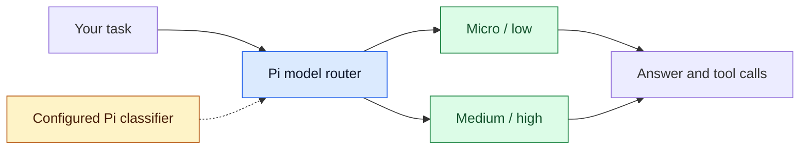

# pi-model-router

[](https://github.com/alexei-led/pi-model-router/actions/workflows/ci.yml)
[](https://www.npmjs.com/package/@alexeiled/pi-model-router)
[](LICENSE)

**Stop changing models by hand.**

Keep one profile in [Pi](https://github.com/earendil-works/pi/tree/main/packages/coding-agent).
`pi-model-router` can select a different model and reasoning effort as the task changes, including between tool-loop requests.
Optional advice uses any text-capable classifier registered in Pi. The router uses Pi’s typed classifier API and requires explicit per-profile approval for the exact model.

## Why use it?

- **Fewer manual changes.** One profile can combine fast, low-cost routes with stronger models.
- **Control over cost and quality.** You choose the models, effort levels, fallback order, and baseline. You can pin a route at any time.
- **Routing modes.** `cost`, `balanced` or `quality` moves each route one step cheaper or stronger, per profile, project or session. [Choose a mode](docs/user-guide.md#choose-a-routing-mode).
- **Activity-specific routes.** Optional sparse code/debug/explore/plan/review/ops/docs overrides share one consent-gated classifier operation. [Configure activity routes](docs/user-guide.md#activity-routes).
- **Adaptive tool loops.** Periodic background reviews assess current work without delaying generation. Eligible recommendations can change tier, activity and effort between requests, with explicit switch-cost controls.
- **Visible decisions.** A compact Signal Panel shows actual activity, model and effort. Held proposals stay distinct. Open `/router` for native bars/sparklines, observed usage and session controls.

The aim is selective use of expensive models, not the cheapest answer at any cost.
Savings depend on your profiles, task mix, output size, and cache reuse.
Advisors add latency. Their fees are separate from generation costs.

## Optional routing advice

Use Jev, Clef/Clef Flash/Clef Omni, OpenAI Decisions, or a local Ollama or llama.cpp classifier registered in Pi.
It reads bounded recent context and advises a model and effort from your profile.
The selected generation model produces the answer, not the advisor.



Configure classifier credentials in Pi and approve its exact `provider/model` reference per profile. Selected text can contain private data. The router sends text only. Without an advisor, it uses a compatible local route.
[Supported models, credentials and configuration →](docs/classifier-advisor.md)

The [reference config](model-router.example.json) selects pinned Jev 1.14 but leaves advice disabled until you opt in.
Missing catalog entries need a Pi provider extension; the [optional catalog example](docs/classifier-advisor.md#1-register-missing-classifier-entries) requires Pi 1.3+.
The router uses one selected classifier, not voting or classifier failover.

## Inspect routing in Pi

Run **`/router`** for five tabs: **Now · Routes · Classifier · Usage · Settings**.
Open any tab with `/router routes`, `/router classifier`, `/router usage` or `/router settings`.
`/router status` returns short text.
The two-line strip is on in new sessions. `/router widget` switches to a quiet footer status instead.


Captured from the local dev extension in Pi inside agterm, using synthetic fixture data.
[Inspector controls](docs/user-guide.md#native-inspector) · [Classifier setup](docs/classifier-advisor.md) · [Native validation and screenshots](docs/testing/router-observability-015-acceptance.md)

## A turn in Pi

This illustrative strip shows a low-tier choice after completion. It is not a routing promise or a latency benchmark.

```text
gpt-6-luna · low · effort off · last
Classifier advice accepted · 807 ms · auto (illustrative historical capture)
```

The model answers and calls tools. Periodic background reviews use bounded current-loop progress; a fresh recommendation may apply at the next request. Cost sensitivity and a short horizon can hold a costly switch, while strong capability advice can override the estimate. Pins, consent and generation safeguards still apply.
[Adaptive routing and switch policy →](docs/user-guide.md#activity-routes)
[Read the status and take control →](docs/user-guide.md#understand-the-result)

Recent records cover 1,967 Pi responses across 25 sessions. They show route use, not guaranteed savings.
[See the chart, cost calculations, and limits →](docs/evaluation.md)

## Upgrading to 0.16.0

Restart Pi after updating. Configuration without `mode` routes as before.
Project `.pi/model-router.json` files can now set only routes, display and
`mode` (security fix). `off`/`minimal` effort at `low` and above disables that
tier. Repeated tool failures now escalate one tier in every mode.
[Upgrade details →](docs/user-guide.md#from-015x-to-0160)

## Upgrading to 0.15.1

If you installed the optional classifier-catalog extension, replace its copy
with the updated example before restarting Pi. This fixes startup failures in
Pi 1.3.0's bundled loader. Updating the router package alone does not update
that separate extension; follow the [catalog update steps](docs/classifier-advisor.md#1-register-missing-classifier-entries).

### From 0.14

Restart Pi after updating. No routing-policy or configuration migration is required from 0.14.
Routes and classifier controls now have their own tabs. Classifier enablement and profile approval remain in user configuration.
History collection is still opt-in: `/router log on` collects new decisions. The inspector makes logging-off state explicit.
Existing pins, effort settings, eligible-route safeguards and four-request review cadence remain unchanged.

### From versions before 0.12.0

After updating, restart Pi. Replace `/router-ui` with `/router`, and
`/router <profile>` with `/router profile <name>`. Classifier advice now uses any Pi-registered classifier. Replace provider-specific configuration with the generic advisor model and exact per-profile approvals.
[Classifier migration →](docs/user-guide.md#from-011x-to-012x)

Old Jev/Clef/chat-classifier settings do not enable the current advisor. Follow the migration steps above even if the old file still loads without a warning.

## Install

Requires Pi **1.1.0 or later in the 1.x series** and Node.js **22.19.0+**.
Automated SDK/host gates run against Pi 1.1.0. The [0.15 native TUI checks](docs/testing/router-observability-015-acceptance.md) use Pi 1.3.0 in agterm. The optional classifier-catalog example requires Pi 1.3+.

```sh
pi install npm:@alexeiled/pi-model-router
```

Then start a new Pi session.
[Create a profile with your available models →](docs/user-guide.md#first-profile)

If you use the upstream package, remove it first. Both packages register the `router` provider.

---

Independent fork of [Ye Liu's pi-model-router](https://github.com/yeliu84/pi-model-router), with the original MIT license and attribution.
