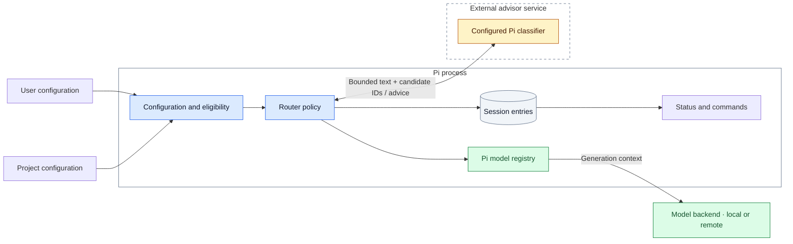
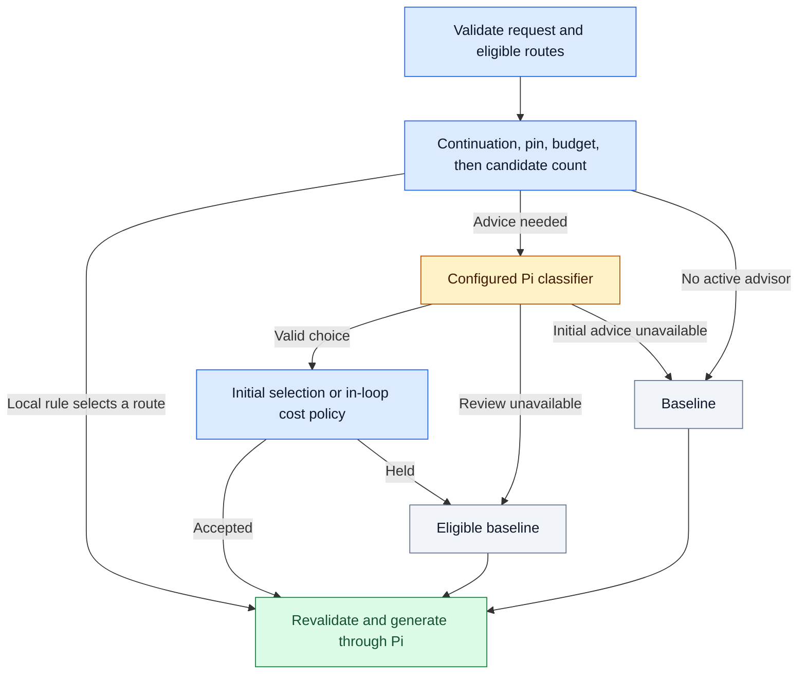
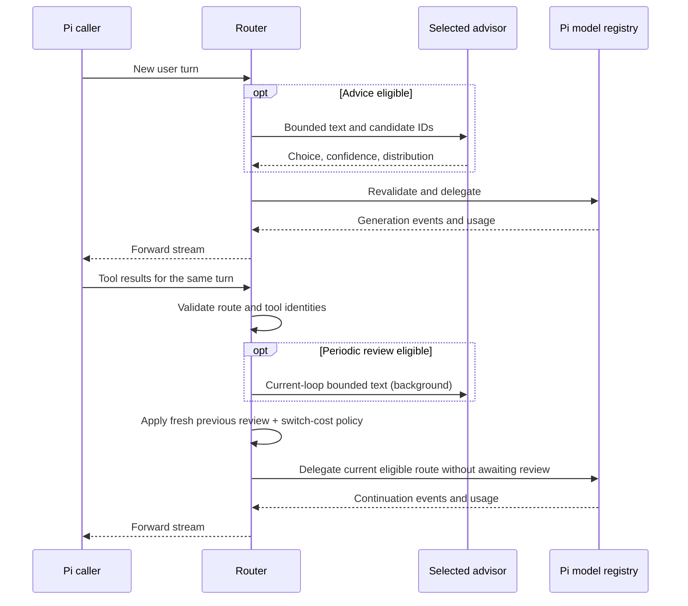

# Architecture

The router is a Pi extension, not a proxy or a second agent runtime.
It keeps `router/<profile>` selected while Pi delegates each request to a concrete model.

## Boundaries

Blue marks routing policy, amber marks advice, green marks generation, and gray marks local state or baseline.
Node labels identify each role without color.

| Owner | Responsibility |
| --- | --- |
| Router | Profile policy, eligible routes, advisor calls, explicit fallbacks, and diagnostics. |
| Pi | Authentication, credential-specific URLs, provider dispatch, transcript conversion, and tool permissions. |
| Structured advisor | Advice among eligible tier candidates. It cannot add models or authorize tools. |
| Operator | Model configuration, provider access, and per-profile approval for external context. |

The router never reads private authentication storage or claims to identify the provider account behind a login.
Only a current locally prevalidated route-matrix cell can authorize generation.
Every configured classifier uses Pi's public classifier registry and authentication. The router owns bounded context selection, candidate validation, deadline policy and user/profile authorization. Project configuration cannot select a classifier or grant profile approval.

## Route selection

A valid continuation normally reuses its actual route. Periodic background classification can recommend a current eligible cell, and a fresh result may apply on the immediately following request after switch-cost policy. Invalid or stale advice retains the valid incumbent. For an invalid continuation, the router chooses a compatible local route without advice; it first tries the model that issued the tool calls in its recorded tier, then the eligible baseline.
A pin or budget decision still takes priority. A mid-loop switch rereads the full context without the turn cache.
Pins and budget policy bypass advisors. One effective plan bypasses advice; a single tier with distinct activity cells can still request activity advice.
The budget is a soft generation-cost policy, not a billing cap.

Eligibility requires provider availability, input support, and at least one allowed effort level.
Local declarations can restrict registry capabilities but cannot grant capabilities.
An unsupported effort runs at the nearest allowed level, as in Pi: the next higher level, else the next lower level.
The route, status line, log, and Pi's footer show the level that runs.

Unpinned selection also skips a route whose context window cannot hold the request at 90% fill.
The request size is the larger of the last valid usage plus later messages and Pi's text estimate of the whole transcript.
If no route fits, the largest windows stay eligible and truncation handles the overflow.
This is a capacity check, not a size preference: every fitting route stays a candidate.
A pin, a Google tool continuation, and explicit generation fallbacks keep their route and rely on truncation.

An eligible `baselineTier` takes priority. The remaining preference is `medium`, `high`, `low`, then `micro`.
Each eligible cell has a primary, or its first eligible fallback when the primary
is ineligible. The generic cell represents a tier when eligible; otherwise its
first eligible activity cell represents it. Off excludes activity cells. The
matrix holds frozen cell declarations and ordered prevalidated physical attempts,
not remote model references. Baseline selection is generic-first within the
budget-applicable pool. See [configuration and baseline details](user-guide.md#activity-routes).
Explicit fallback models retain their configured order. They are not extra classifier candidates.
Prompt words, language, length, and inferred task phase never select a local tier.

## Advisor contract

The selected Pi classifier receives bounded current text,
recent dialogue, and permitted tool evidence.
It never receives system prompts, tool definitions, thinking blocks, tool arguments, binary blocks, or raw configuration.
Selected text can still contain private data. Filtering is not redaction.

A candidate ID represents the tier, canonical representative model, and effort.
An optional activity answer is validated independently and resolves the actual matrix cell;
it cannot extend the matrix or change the cell's generation fallback list.
The adapter rejects unknown IDs, invalid confidence, malformed distributions, and oversized responses.
It accepts only a current candidate. The [classifier guide](classifier-advisor.md) documents configuration and probability selection.

One absolute deadline covers context preparation, HTTP attempts, backoff, and response reading.
Only documented transient statuses qualify for a retry inside that deadline.
Pi classifier retries run only within the shared total deadline.

## Route reuse and generation

Concurrent callers for one turn share the advisor request and its deadline.
Only the last departing caller can cancel the shared initial transport. Background reviews have their own bounded lifetime linked to the caller and provider registration. Their branch snapshot is checked as ancestry, not exact full-branch equality; normal assistant/tool appends do not invalidate a fresh result.
The bounded cache stores the actual successful route and its immutable selected-cell plan, not only the advisor label. Reuse clears request-local switch/proposal diagnostics. Every terminal background-review observation is allowlisted and recorded separately from generation when history collection is enabled; unique classifier IDs deduplicate a consumed review's repeated metrics.

Reuse requires matching session, user turn, profile, policy, configuration, branch ancestry, model, and tool-result identities.
When the caller omits `sessionId`, the key uses Pi's native session ID.
Changed capabilities or configuration invalidate reuse. New user-role steering messages change turn identity and abort prior background review. Valid tool-result continuations may schedule a periodic nonblocking classifier review; only the immediately following request may consume it. Branch/policy/plan/matrix identity changes and expiry drop the result. The original provider `sessionId` passes through unchanged.
Context truncation, the last resort after the window check, removes complete old user turns and preserves system instructions and the active tool chain.
Its text estimate does not guarantee a fit for images or oversized active turns.

## Native child integration boundary

Fresh Pi SDK sessions use fresh extension factories, resource loaders and model
runtimes. Router state is owned by the native session, not the transport
`options.sessionId`; explicit transport IDs still pass through unchanged.
Native lifecycle replacement/reload/shutdown aborts the old request lifetime,
advances a request epoch and resets provider caches. Stale provider registrations
and delayed advice/generation cannot mutate the replacement owner's controls,
UI, persistence or cost. Foreign lifecycle events cannot take ownership of an
initialized runtime. A new fork ignores foreign-owner (and legacy unowned)
snapshots. Same-owner branch restoration remains supported.

**Native pi-subagents auto-integration is not implemented.** The current public
provider `streamSimple(model, context, options)` API does not identify its native
caller. A child calling an inherited parent provider is indistinguishable from
a legitimate transport session-ID override. The router does not claim to detect
or fail-close such calls. Do not share router extension/provider runtimes across
parent and child sessions.

Safe upstream integration requires a supported public contract providing:

- A fresh session-local extension factory/runtime and provider registration.
- Native caller/session binding available to delegation, independent of transport IDs.
- The child's effective **physical** model allowlist, after inherited restrictions.
- Its inherited maximum thinking level, distinct from the current effort setting.

Pi 1.1.0's `ExtensionContext.scopedModels`/SDK `scopedModels` describe session
model cycling; `thinkingLevel` describes current effort. They do not establish
the effective inherited physical scope or thinking ceiling required here.
The router does not reinterpret them as that security contract, invent a private
environment carrier, add a pi-subagents dependency, or auto-register unrestricted
child routes. In-memory SDK isolation tests establish only fresh-runtime behavior,
not native pi-subagents policy propagation.

## Failure behavior

| Event | Router action | Boundary |
| --- | --- | --- |
| Initial advisor times out, abstains, or returns invalid advice. | Select the eligible baseline. | Do not call a second advisor. |
| Background review fails, is stale or expires. | Keep the valid eligible incumbent. | Do not delay generation or apply old advice. |
| An explicit pin has no eligible route. | Return an error. | Do not substitute another tier. |
| The caller cancels. | Stop the request. | Do not start baseline generation or retry. |
| Generation fails before visible content. | Try the next configured fallback, or return an error. | Revalidate the target and account for reported costs. |
| Generation fails after visible content. | End the response with an error. | Do not retry on another model. |
| The stream ends without a terminal event. | Return an incomplete-stream error. | Apply the same visibility and cancellation limits to retries. |
| A Google thought-signature continuation loses its compatible prior model. | Fail the continuation. | Do not send it to an incompatible model. |

## State and cost

| State | Lifetime | Contents |
| --- | --- | --- |
| Runtime route cache | Current process | Turn hashes, branch identity, tool IDs, shared advice, and eligible routes. |
| `router-state` entries | Pi session branch | Profile, pins, cost, display controls, latest decision, and up to 50 debug decisions, with native owner identity. |
| Profile preference file | Across sessions | Last explicitly selected profile. Explicit startup selection takes priority. |

Snapshots use deep copies and field-level validation.
They exclude raw advisor responses, prompts, credentials, endpoints, and remote explanations.
Local classifier request IDs support deduplication within retained history. They are not provider authentication or cache-affinity IDs.

Every terminal attempt contributes its reported cost before a fallback decision.
Missing usage remains unknown. Advisor costs are outside the generation budget.
The final UI update cannot prevent persistence.

`economics.ts` calls Pi `calculateCost()` for hypothetical cache scenarios on the same measured token workload, including request-wide input pricing tiers.
This diagnostic comparison does not itself select routes. `switch-policy.ts` separately prices a cold first target request plus a bounded cache-read horizon and compares it with the incumbent estimate using the last observed read share. Cost sensitivity controls the accepted premium for fresh in-loop advice; relevant strong tier/activity advice may override it. New user-turn advice starts a new task and is not held by the previous task's estimate. Both stay and future target requests use the same observed read-share scenario; the first target request is cold. Rebuild premium and steady price difference are separate diagnostics, and shared-effort rebuild metadata never implies free generation. An explicit exact-model `effortCacheSharing: shared` declaration removes cache rebuild cost for same-model effort changes; unknown metadata allows the change without claiming preservation. These catalog scenarios contain no physical cache state or guessed TTL.
A restored branch does not restore a server cache. Same-model effort changes without explicit metadata do not imply cache preservation.
The [evaluation](evaluation.md#cost-method) states the cost assumptions and evidence limits.

## Module ownership

| Module | Responsibility |
| --- | --- |
| `index.ts` | Wire Pi lifecycle hooks, extension state, branch restoration, commands, provider, and UI. |
| `config.ts` | Load, merge, validate, and normalize configuration. |
| `domain.ts` | Parse canonical model references and validate pure tier, effort, and pin values; no config I/O. |
| `routing.ts` | Build immutable eligible cell plans and apply baseline, pin, budget, input, context-fit, and effort policy. |
| `provider.ts` | Register logical profile models from live capabilities, create the provider-scoped turn cache, and adapt Pi's stream API. |
| `provider-request.ts` | Build turn identity, validate continuation reuse, resolve a current matrix cell, and coordinate classifier advice. |
| `provider-turns.ts` | Keep bounded continuation/advice caches and retain selected plans and reference-count shared classifier flights for one session-owned provider registration. |
| `provider-generation.ts` | Revalidate physical targets, run configured generation fallbacks before visible content, account for attempts, and forward events. |
| `provider-runtime.ts` | Wait for the model registry and bridge request preparation/generation to Pi streams, persistence, and status updates. |
| `context.ts` | Select bounded classifier text and extract generation input. |
| `classifier.ts` | Build typed bounded requests, call Pi's classifier registry, enforce deadlines, and validate advice. |
| `choice.ts` | Define the provider-neutral rubric, candidate identity, and strict response validation. |
| `economics.ts` | Produce observed generation metrics and diagnostic hypothetical comparisons. |
| `switch-policy.ts` | Evaluate catalog switch estimates, exact-model effort/cache metadata, confidence override and cost holds. |
| `state.ts` | Validate, copy, and persist allowlisted branch-safe snapshots. |
| `commands.ts` | Register router commands and completions. |
| `ui.ts` | Format and publish the route strip and expose the native inspector entrypoint. |
| `ui/runtime.ts` | Own transient snapshots, queued control transactions, observations, and capability revalidation. |
| `ui/controls.ts` | Validate control edits without terminal dependencies. |
| `ui/presentation.ts` | Format sanitized snapshots and fixed local reasons without host or terminal dependencies. |
| `ui/inspector.ts` | Render and operate the native Pi terminal inspector. |
| `types.ts` | Define shared contracts. |

Request preparation applies routing policy and uses provider-scoped coordination for classifier advice. Generation validates and delegates each physical target through Pi. State and UI do not import provider or classifier transport. `ui/controls.ts` and `ui/presentation.ts` do not import the terminal inspector, TUI, or Pi transport APIs. `domain.ts` has no configuration I/O. Structured classification and generation both use Pi's registry, not a parallel authentication layer.

The Signal Panel reads a sanitized presentation snapshot through one `/router`
command family. `ui/presentation.ts` formats fixed local reasons and bounded bars.
It makes no advisor calls. The widget and fallback footer status are mutually
exclusive. Wide inspectors are floating right overlays, not transcript-reflowing sidebars; narrow custom screens replace the editor area while preserving the host footer and widgets. The host footer stays intact. Now, Usage and Settings share one draft.
Recorded session cost is projected separately from retained-window history.
Provider observations distinguish
selected advice from attempted/actual generation and cannot affect routing or retries.
A request epoch rejects stale UI observations after a newer request or session reset.
Pending session controls use field-level compare-and-set, activate before the next user run,
and are revalidated against current capabilities. They never enable privacy settings.
The inspector's transient state is cleared on reload, session replacement, and shutdown.
Activated pins and effort retain the existing branch persistence.
Usage is a projection of the profile's retained debug history, not a new accounting ledger.

Strict TypeScript, Biome cycle and directional-import rules, a production-only complexity ratchet, and per-module V8 coverage gates protect these boundaries. Behavior tests use Pi 1.1.0 types, real host startup, and in-memory providers. Classifier transport tests use synthetic fixtures. They do not use live credentials.
