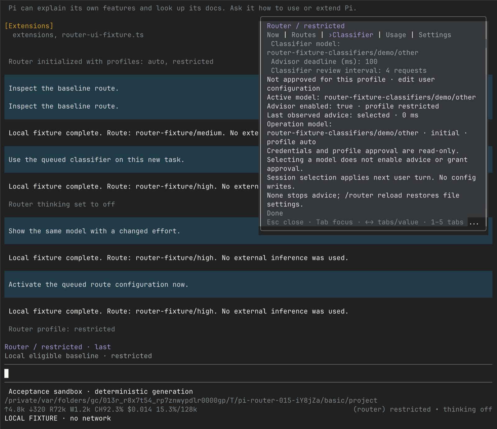
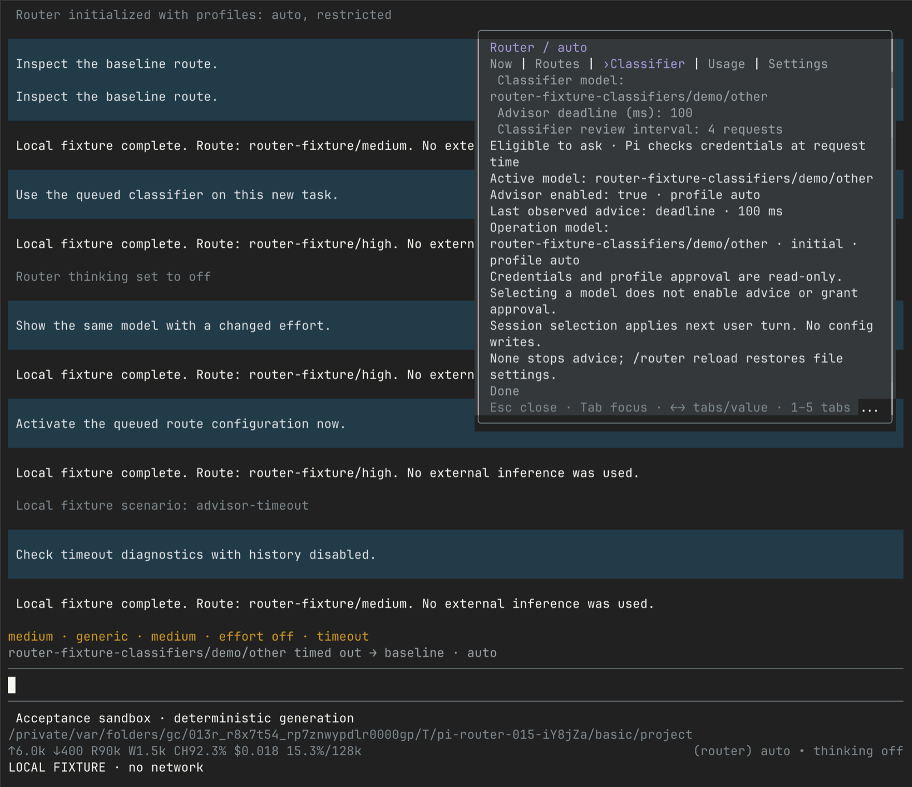

# Classifier advisor

The router uses one text-capable classifier from Pi's public registry. Pi owns
provider APIs and authentication. The classifier advises a route; a separate
generation model answers the user.

**Setup order:** register the classifier → authenticate in Pi → select and approve
its exact reference in user configuration → reload → inspect the decision.
A model appearing in the catalog does not prove that its credentials or server work.

## Supported models

| Classifier                  | Canonical reference                               | Setup                                                            |
| --------------------------- | ------------------------------------------------- | ---------------------------------------------------------------- |
| Jev 1.14, pinned version    | `typesafe/jev-1.14.0`                             | Register if absent; TypeSafe API key                             |
| Jev, provider-managed alias | `typesafe/jev-latest`                             | Pi's built-in TypeSafe classifier; alias can change              |
| Clef                        | `cloudflare-workers-ai/@cf/cloudflare/clef`       | Cloudflare API key and account ID                                |
| Clef Flash                  | `cloudflare-workers-ai/@cf/cloudflare/clef-flash` | Same Cloudflare credentials                                      |
| Clef Omni                   | `cloudflare-workers-ai/@cf/cloudflare/clef-omni`  | Register if absent; same Cloudflare credentials                  |
| OpenAI Decisions            | `openai/gpt-6-luna`                               | OpenAI API key, not ChatGPT/Codex subscription credentials       |
| Local Ollama / Nimble       | `ollama/nimble`                                   | Register classifier; Ollama 0.35+ running with Nimble downloaded |
| Local llama.cpp             | `llama.cpp/<registered-model-id>`                 | Connect and load a compatible model through Pi                   |

Other Pi-registered text classifiers work through the same path. The router
does not limit selection to this table. It does not combine classifier answers
or fail over to a second classifier.

### Pinning Jev 1.14

Use `typesafe/jev-1.14.0` to request that exact version.
[TypeSafe's model documentation](https://docs.typesafe.ai/models) currently
points `jev-latest` at 1.13 and `jev-preview` at 1.14.
Jev 1.14 uses the same System One choice-question contract.

The reference configuration selects Jev 1.14 as an example but leaves the advisor
disabled. The router itself has no default classifier. A configured reference
does not register a missing model or enable external requests.

## Configure a model

### 1. Register missing classifier entries

First inspect **`/router classifier` → Classifier model**.
The list comes from Pi's registered text-classifier catalog.

Install the optional catalog extension only if a classifier you want is missing.
Pi and the router work without it: use an existing registered classifier, or
leave advice disabled to use the configured eligible baseline.

The router package does not install extra provider catalogs. For Pi **1.3+**,
the optional [classifier catalog example](examples/classifier-catalog.ts)
adds Jev 1.14, Clef Omni and local Ollama/Nimble. It reuses Pi's native API
implementations and preserves their built-in catalogs. Pi's `models.json`
overrides still apply.

From a checkout of this repository:

```sh
mkdir -p ~/.pi/agent/extensions/classifier-catalog
cp docs/examples/classifier-catalog.ts ~/.pi/agent/extensions/classifier-catalog/index.ts
```

Copying the example into this directory makes it a globally discovered Pi
extension. Pi loads it at startup even when router advice is disabled; an import
failure can prevent startup. Registration alone does not enable advice or send
classification requests.

The example imports `builtinProviders` through
`@earendil-works/pi-ai/providers/all`, which Pi's bundled extension loader exposes.
It preserves the TypeSafe and Cloudflare catalogs and reuses the TypeSafe
classifier implementation for local Ollama. Direct imports of individual
provider or API modules can fail in the bundled loader even when their files
exist in the installed package.

Do not load it alongside another extension that owns the `typesafe`,
`cloudflare-workers-ai` or `ollama` provider ID.

Updating the router npm package does not replace a separately installed catalog
extension. After updating this checkout, copy the example again and restart Pi.
If chezmoi manages the target, update its source instead:

```sh
chezmoi source-path ~/.pi/agent/extensions/classifier-catalog/index.ts
```

Copy the repository example to the source path printed above, then apply only
that target and restart Pi:

```sh
chezmoi apply --include files ~/.pi/agent/extensions/classifier-catalog/index.ts
```

To check the example against an installed Pi 1.3+ without inference, run this
from the checkout:

```sh
PI_TEST_BINARY="$(command -v pi)" npm run test:classifier-catalog
```

The explicit executable avoids npm selecting this checkout's Pi 1.1 test
dependency. The check starts an isolated Pi RPC session with only this extension
and checks that startup succeeds.

Pi 1.3's `models.json` adds chat models, not classifier entries. Register missing
classifier metadata through a Pi provider extension.
The example uses `typesafe-system-one` for Jev and Ollama, and
`cloudflare-workers-ai-system-one` for Clef Omni.
See [Pi's custom-provider guide](https://github.com/earendil-works/pi/blob/v1.3.0/packages/coding-agent/docs/custom-provider.md).

### 2. Authenticate or start the local service

Keep credentials in Pi, never in `model-router.json`.
Run `/login` and choose the provider's API-key method, or use the environment
variables below. Local Ollama does not require a real API key.

- **TypeSafe:** configure the provider through Pi, or set `TYPESAFE_API_KEY`.
- **Cloudflare:** configure the key and account ID through Pi, or set
  `CLOUDFLARE_API_KEY` and `CLOUDFLARE_ACCOUNT_ID`.
  [Clef Omni](https://developers.cloudflare.com/workers-ai/models/clef-omni/)
  uses the same account and API as Clef.
- **OpenAI:** use API-key authentication for the `openai` provider.
  [Decisions](https://developers.openai.com/api/docs/guides/decisions) does not
  accept ChatGPT/Codex subscription tokens. Stored OAuth credentials can take
  precedence over `OPENAI_API_KEY`; setting that variable alone does not change
  an existing login method.
- **Ollama:** start the Ollama app, or run `ollama serve` in another terminal.
  Then download the decision model:

  ```sh
  ollama pull nimble
  ```

  [Ollama's native decision API](https://docs.ollama.com/capabilities/decision)
  uses `/v1/systemone`. The example defaults to local port 11434 and respects
  existing `ollama` provider settings in Pi's `models.json`.
  A remote endpoint override sends text to that server, not necessarily your machine.
  A regular Ollama chat model does not become a classifier because it can
  generate JSON. Catalog registration does not start the server or download weights.

- **llama.cpp:** use Pi's `/login llama.cpp` and `/llama` controls.
  Select the exact classifier ID Pi registers for the connected model.

All routing advice is **text-only**, including when the selected classifier can
process images, audio or video.

### 3. Select and approve the classifier

Put advisor settings in **user** `~/.pi/agent/model-router.json`.
A custom Pi agent directory changes this path.
Merge these settings with your existing profiles, or adapt this complete example:

```json
{
  "debug": true,
  "advisor": {
    "enabled": true,
    "model": "typesafe/jev-1.14.0",
    "timeoutMs": 10000,
    "reviewEveryRequests": 4,
    "confidenceThreshold": 0.65,
    "probabilityThreshold": 0.8,
    "maxStateTokens": 3000,
    "maxRetries": 1
  },
  "profiles": {
    "personal": {
      "advisor": {
        "models": ["typesafe/jev-1.14.0"]
      },
      "high": {
        "model": "openai-codex/gpt-6.1-sol",
        "thinking": "high"
      },
      "medium": {
        "model": "openai-codex/gpt-6.1-terra",
        "thinking": "medium"
      },
      "low": {
        "model": "openai-codex/gpt-6-luna",
        "thinking": "high"
      }
    },
    "work": {
      "advisor": { "models": [] },
      "medium": {
        "model": "openai-codex/gpt-6.1-sol",
        "thinking": "medium"
      }
    }
  }
}
```

Replace the **generation** references with models available in your Pi setup.
They are not the classifier model.

`profiles.<name>.advisor.models` is an approval list, not a fallback chain.
Only the globally selected classifier receives text. An empty list disables
advice for that profile. Approval for one profile does not approve another.

References must be exact `provider/model-id` values. Router aliases such as
`fast` are not accepted. A qualified Pi catalog ID such as
`typesafe/jev-latest` is accepted, but can resolve to a different upstream version.
Project `.pi/model-router.json` cannot select, tune, enable or approve classifiers.

### 4. Reload and check the result

After adding or changing a provider extension, run **`/reload`** in Pi.
After changing only router configuration, run **`/router reload`**.

Then run:

```text
/router profile personal
/router log on
```

Send a new user request, then inspect `/router` or `/router log`.
The **Now** section shows the physical generation model.
Pi's normal model label can remain `router/personal` while the physical route changes.

`/router log on` starts collecting new decisions immediately. Use
`/router log off` to stop collection. Neither command reconstructs older history.
`/router reload` preserves the current logging toggle, even after changing
`debug` in the file. Resumed sessions also restore their saved toggle.
Use the log commands to change collection in an existing session.
The Usage screen's zero retained decisions does not mean no generation occurred.

## Change classifier

Change **both** the selected model and the active profile's approval list.
For example, merge these fields into the existing user configuration:

```json
{
  "advisor": {
    "enabled": true,
    "model": "cloudflare-workers-ai/@cf/cloudflare/clef-omni"
  },
  "profiles": {
    "personal": {
      "advisor": {
        "models": [
          "typesafe/jev-1.14.0",
          "cloudflare-workers-ai/@cf/cloudflare/clef-omni"
        ]
      }
    }
  }
}
```

This fragment does not replace your profile's generation tiers.
Use another exact reference from the table for OpenAI, Ollama or llama.cpp.

The **Classifier** tab selects a registered text classifier as a **session override**.
Left/Right visits every catalog entry without reordering it. Apply queues the
selection for the next user turn. Selecting **None (session)** stops advice at
that boundary. `/router reload` restores file-backed settings.
The inspector cannot enable advice or grant profile approval. Credentials and
profile approval stay read-only. Session selections reset on reload or replacement.

The tab distinguishes disabled, missing registration, unsupported text input and
missing profile approval. It labels the active selection separately from the
last observed operation's model, source and profile. Diagnostics remain available
with logging off. **Eligible to ask** is not an authentication attestation.




See [inspector controls and screenshots](user-guide.md#native-inspector).

## Advisor configuration reference

These are router defaults, not guaranteed model-specific optima.

| User configuration field              | Default      | Meaning                                                                              |
| ------------------------------------- | ------------ | ------------------------------------------------------------------------------------ |
| `advisor.enabled`                     | `false`      | Enable only with explicit `true`; omitted advisor means no classifier calls          |
| `advisor.model`                       | None         | Required exact Pi classifier reference when configuring an advisor                   |
| `profiles.<name>.advisor.models`      | None         | Exact references approved for this profile; does not register or select models       |
| `advisor.timeoutMs`                   | `10000`      | Total deadline, including retries; positive and at most 2147483647 ms                |
| `advisor.reviewEveryRequests`         | `4`          | Background review interval, 0–1000 requests; 0 disables reviews, not initial advice  |
| `advisor.confidenceThreshold`         | `0.65`       | Top-choice and activity confidence threshold, 0–1                                    |
| `advisor.probabilityThreshold`        | `0.8`        | Cumulative tier-probability threshold, greater than 0 and at most 1                  |
| `advisor.maxStateTokens`              | `3000`       | Selected text budget, 1–24000 estimated tokens; typed request metadata adds overhead |
| `advisor.maxRetries`                  | `1`          | Pi retries, 0–4, inside the same deadline                                            |
| `advisor.temperature`                 | Unset        | Optional positive finite value forwarded to Pi's classifier API                      |
| `advisor.context.currentLoopMessages` | `8`          | Current-loop message window, 0–40 messages                                           |
| `advisor.context.previousTurns`       | `2`          | Earlier dialogue turns, 0–20                                                         |
| `advisor.context.maxHistoryTokens`    | `500`        | History text sub-budget, 0–24000 tokens, within the total                            |
| `advisor.context.toolResults`         | `last-error` | `none`, `last`, `last-error` or opt-in `recent`                                      |
| `advisor.context.maxToolTokens`       | `250`        | Tool-result text sub-budget, 0–24000 tokens, within the total                        |

`debug` controls retained local history, not whether classification runs.
The [complete reference configuration](../model-router.example.json) leaves
both classification and debug collection off until you enable them.
Credentials, endpoints and API keys are not valid advisor fields.

## Bounds and selection

The default deadline is 10 seconds and covers local context preparation plus classification. Caller cancellation aborts the operation and does not start generation. Pi retries according to `advisor.maxRetries` (default 1 retry), within the same total router deadline.

An initial user request makes one approved `modelRegistry.classify()` operation and awaits it. On valid tool continuations, the router can make a separate background review every `advisor.reviewEveryRequests` requests (default 4; 0 disables). It never waits for that review before generation. A completed review is eligible only on the immediately following request; otherwise it expires. Session/branch/turn/config/policy/matrix changes invalidate it. Failed, uncertain or stale reviews keep the eligible incumbent instead of resetting a running task to the baseline. Initial new-user advice is not held by the previous task's cache economics; fresh in-loop proposals use the [switch policy](user-guide.md#read-costs-and-cache-data). Every completed review's allowlisted diagnostics can enter retained history, including reviews that never apply; unknown or late/unreported costs remain unknown, not free.

Both initial choices and reviews use one approved `modelRegistry.classify()` operation. Normally it
asks the existing typed `route` choice among eligible tier representatives and
`uncertain`. Candidates show the prevalidated default-owned preferences or custom transforms after the [routing mode](user-guide.md#choose-a-routing-mode) is applied. [Built-in presets](activity-routing.md) supply specialization cells for recognized profiles without enabling or approving advice. With activity routing on and meaningful eligible specialization
plans, it also asks a separate typed `activity` choice. These are independent
answers in the same operation, not a multiplied joint distribution or a second
advisor call. Pi may implement the operation using several bounded HTTP requests.

Tier selection keeps the existing rule: accept the top candidate at or above
`confidenceThreshold`; otherwise choose the lowest tier whose cumulative
probability reaches `probabilityThreshold`, counting abstention mass at the local
baseline tier. Activity needs a valid choice/distribution and confidence at or
above `confidenceThreshold`; it never uses the cumulative tier rule.

A valid activity resolves the chosen tier's current prevalidated cell, or its
generic plan if there is no eligible specialization. Missing, malformed,
low-confidence or `uncertain` activity keeps valid tier advice but uses that tier's
generic plan; if it is unavailable, use the deterministic eligible baseline.
Invalid tier advice or a whole classifier error goes directly to baseline, never
to another advisor. Representative IDs cannot themselves authorize a physical
target. Generation revalidates each attempt in the selected cell's immutable plan.

One tier with distinct activity plans asks only `activity`. One effective plan
bypasses advice. Off/no meaningful overrides preserve the old route-only request
and selection behavior. An effort override that erases activity differences also
removes the activity question.

A profile pin and soft-budget policy bypass advice. One effective plan bypasses advice. Tool continuations reuse a valid route unless an eligible background review is ready at the next request. The advisor cannot introduce a route or change generation permissions.

## Privacy

A classifier call sends the current user goal plus bounded recent assistant text and permitted text tool results, including the current tool loop, and configured previous dialogue. `advisor.context.currentLoopMessages` bounds current-loop messages (default 8). When loop messages exist, half the text budget is reserved for the goal so recent progress can remain visible. `toolResults` defaults to `last-error`: only the latest result when it failed. `last` sends one latest result, `none` excludes results, and opt-in `recent` sends bounded results from the current-loop window. Successful current-loop results do not revive a previous task's old error. History and tool token limits share the total text budget. The extension excludes system prompts, tool definitions, thinking, tool arguments, image/binary blocks, and raw router configuration. Text filtering is **not redaction**; selected conversation text can contain private information.

Classifier models that accept images are supported by Pi, but the router does not attach transcript images to classification requests. Use explicit user/profile configuration to control whether the router sends text to an external classifier.

The router retains allowlisted local model identity, numeric usage/cost diagnostics, and route-selection results. It discards provider error text and classifier explanations. Pi remains responsible for authentication and model execution.

## Troubleshooting

| Symptom                                                  | Check                                                                                                                                                                                             |
| -------------------------------------------------------- | ------------------------------------------------------------------------------------------------------------------------------------------------------------------------------------------------- |
| `Classifier unavailable → baseline`                      | Check registration, Pi credentials, `advisor.enabled` and the active profile's exact approval. Initial advice failure uses the baseline; a failed background review keeps the eligible incumbent. |
| Authentication or API error                              | Configure credentials in Pi, not router configuration. For OpenAI, use API-key authentication rather than ChatGPT/Codex subscription tokens.                                                      |
| Timeout                                                  | Raise `advisor.timeoutMs` within its documented range, or choose a faster configured classifier. Local model loading also consumes the deadline.                                                  |
| Model does not appear in Settings                        | Register it in Pi first, then `/reload` after adding a provider extension. The router cannot create a classifier from a name alone.                                                               |
| Selecting a model still does not run it                  | The inspector cannot enable the advisor or grant approval. Update user configuration, then `/router reload`.                                                                                      |
| Enabled and approved, but no classifier call             | Check for a pin, an exceeded soft generation budget or only one effective eligible plan. These bypass advice.                                                                                     |
| The model name does not change                           | Tiers can use one physical model with different effort. Inspect actual tier/effort in Now, not only Pi's logical `router/<profile>` label.                                                        |
| Jev still uses 1.13                                      | Use the pinned `typesafe/jev-1.14.0` reference instead of assuming `jev-latest` resolves to 1.14.                                                                                                 |
| Ollama is listed but requests fail                       | Confirm the server is running, Nimble is downloaded, and the configured endpoint supports `/v1/systemone`. A catalog entry is not a server health check.                                          |
| Usage has zero retained decisions                        | Run `/router log on` and send a new request. Old history is not reconstructed.                                                                                                                    |
| Legacy `jev` settings load but routing stays at baseline | Follow the [migration steps](user-guide.md#from-011x-to-012x). Retired provider settings do not enable the current advisor.                                                                       |
| Image classification was expected                        | The router intentionally sends text only.                                                                                                                                                         |

Pi model reference: [Use classifier models](https://github.com/earendil-works/pi/blob/v1.3.0/packages/coding-agent/docs/models.md#use-classifier-models).
