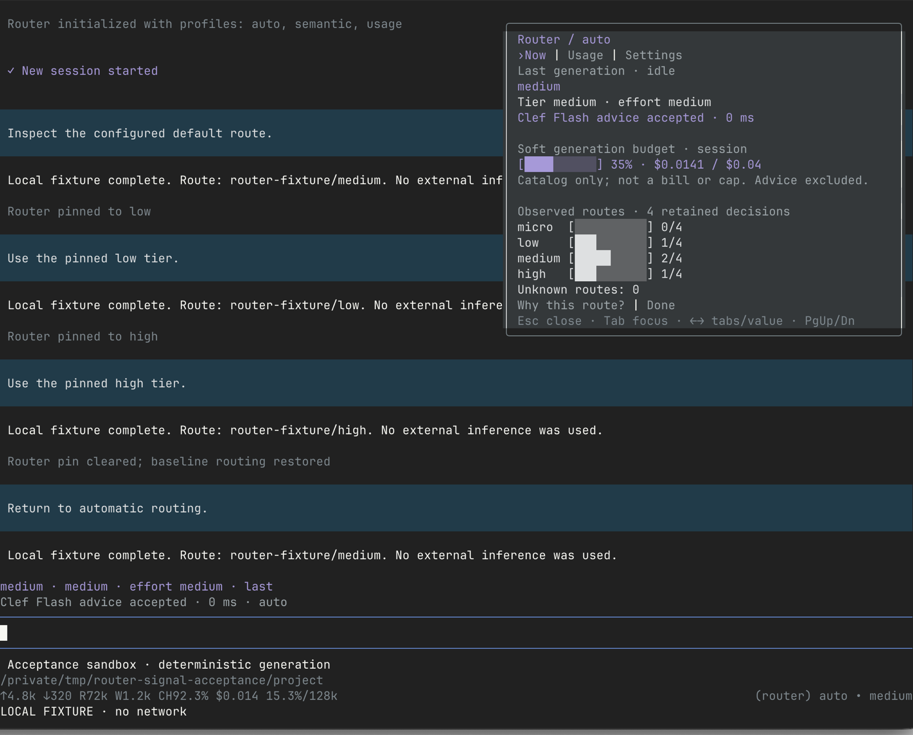
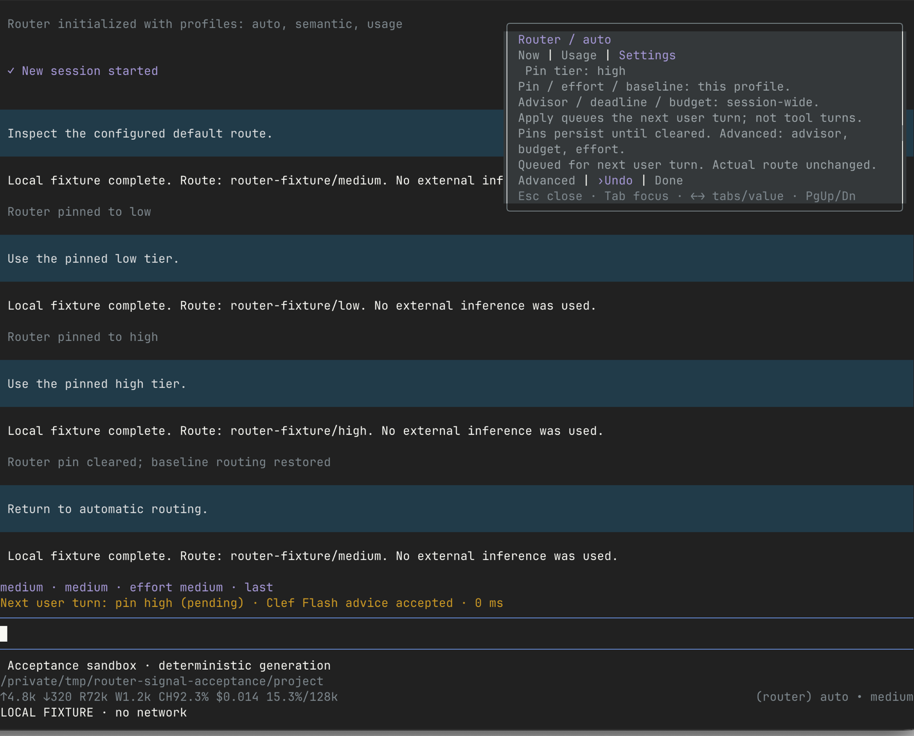
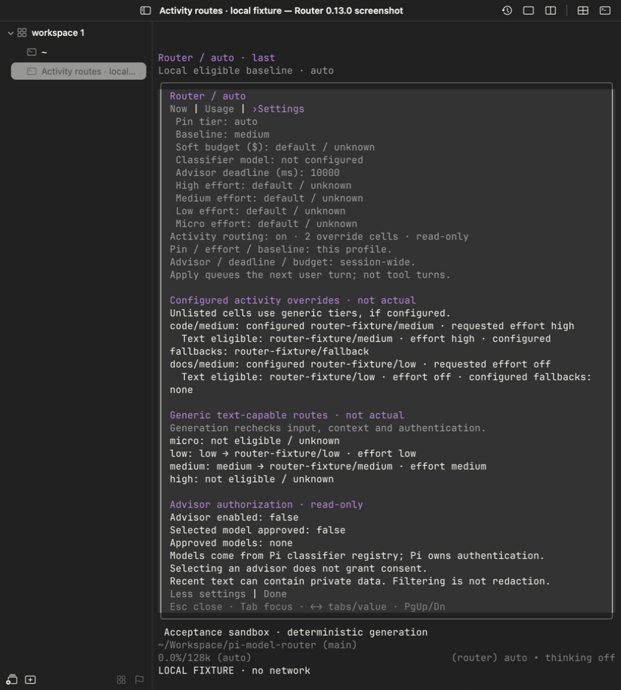
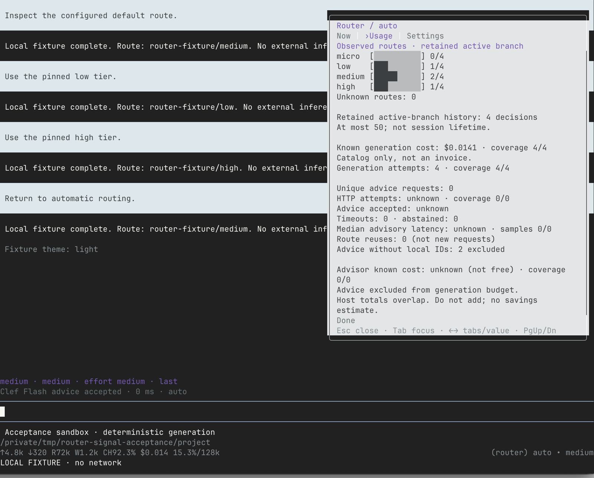
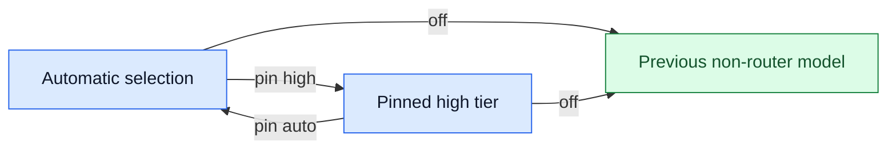

# User guide

A profile maps up to four tiers to models and reasoning effort.
The tiers are `micro`, `low`, `medium`, and `high`. They do not control tool permissions.
Pi supplies the providers, credentials, and tool permissions.

## First profile

1. Open Pi's `/model` selector to find available models.
2. Authenticate the chosen providers through Pi.
3. Create `~/.pi/agent/model-router.json`.
4. Add a profile to that file.

This example uses illustrative model references. Replace them with models and effort levels that your Pi registry supports.

```json
{
  "profiles": {
    "auto": {
      "baselineTier": "high",
      "high": { "model": "openai/gpt-6-astra", "thinking": "high" },
      "low": { "model": "openai/gpt-6-luna", "thinking": "off" }
    }
  }
}
```

5. Run `/router reload`.
6. Run `/router profile auto`.
7. Send a short request, such as `Reply with ready.`
8. Run `/router` to inspect the result.

With this profile and no active advisor or pin, the completed route has this
illustrative two-line strip:

```text
gpt-6-astra · high · effort high · last
Local eligible baseline · auto
```

The baseline is the configured default, not a tier inferred from prompt words.

## Understand the result

| Field | Meaning |
| --- | --- |
| Model ID | The actual generation target, not just the advisor's choice. |
| Tier / effort | The configured tier and reasoning effort that ran. Narrow strips omit secondary fields first. |
| `last` | The last completed route, not a currently running request. |
| Advisor name | The configured Pi classifier model reference. |
| `Tool route reused` | No new advisor request. Prior latency is not presented as a new request. |
| `timed out → baseline` | Advice failed but an eligible generation baseline ran. |
| `Explicit generation fallback` | Another configured generation target ran, possibly in the same tier. |
| `Next user turn` | Applied controls waiting for a user turn; actual generation is unchanged. |

The strip uses two lines. Hide it with `/router widget` to use one compact footer
status instead. The router never replaces Pi's footer or repeats its own route
in both places. Warning colors mark recovered problems and budget policy;
generation failure uses the error color. Colors always have text labels.

## Native inspector

Run **`/router`**, **`/router usage`** or **`/router settings`**.

- **Now:** actual model, activity, tier and effort. A held proposal is labeled separately and explains its switch-cost estimate.
- **Usage:** up to 50 retained decisions, route mix, observed activity labels, per-request catalog-cost sparkline and last measured cache-read share. These are observations, not quality or future-cache predictions.
- **Settings:** pin first. **Advanced** exposes baseline, budget, all-activity per-tier effort, Pi classifier, deadline, review interval, switch horizon/sensitivity, strong-advice threshold and **Routes**.
  The separate Pi classifier path is shown when configured.
  Settings also shows the activity-routing mode and override count.
  Adaptive switch controls queue until the next user turn. Changing review interval to 0 disables background reviews; it does not disable initial classifier advice.
  **Routes** opens a native per-cell editor. Select an activity/tier, search registered physical chat models (logical `router/*` models are excluded), and choose an effort supported by that model. The editor labels inherited versus overridden cells and can reset a cell to generic inheritance. It retains the cell's ordered fallback chain. Edits use compare-and-set transactions and queue for the next user turn; browsing, drafting and applying pending settings do not change the actual route or write configuration files. The selector reads the public model registry only; it does not check credentials, call a classifier or change approval.
  The read-only route summary lists effective configured activity cells, their ordered fallback declarations and first currently text-eligible attempt (or unavailable/unknown state). Unlisted cells use generic tiers, if configured; mode off retains the declarations but excludes them. These are not advised or actual routes, and generation still rechecks request input, context fit and authentication.
  A per-tier effort override applies to every activity and takes precedence over a cell's configured effort. The editor shows both values; clear the tier override to use the cell effort.

Use Left/Right on the tab row to change sections. Tab/Shift+Tab changes focus.
On a selector, Left/Right or Enter changes the value. Numeric fields use normal
text editing. Page Up/Down scrolls. Enter activates the focused action.
In Routes, Enter opens the native activity/tier, model or effort selector; model
search uses the Input field, then Tab moves focus to the SelectList. Apply/Discard
appear only with a changed draft. Undo appears after applying controls.
Escape returns from a Routes selector to the editor, then from Routes to Settings;
from the main inspector it closes and discards unapplied edits.

The inspector is a content-sized right overlay at 100 columns or wider. It
covers rather than reflows the transcript. Narrow terminals use a custom
screen. Resizing preserves the draft, section and expanded details; focus
returns to the section row. Mouse input is not required.

Outside TUI, the same commands return text without inference. Print writes to
stderr (`pi --print '/router usage' 2>&1`). JSON emits a `router-inspector`
message; RPC uses notifications. `/router status` always returns short text
(JSON: `router-status`).



**Apply queues changed fields for the next user turn**, not the next tool
request. It does not change the displayed actual route. Discard affects only
the draft. Undo reverses only unchanged editor-owned fields. Conflicting edits
are rejected rather than overwritten.

Pin, all-activity effort and baseline are profile-scoped. Per-cell activity route edits are session-only profile overrides. Advisor, deadline, budget, review cadence and switch-cost policy are session-wide and activate on the next user turn even after a profile switch.
No configuration files are written. Activated pins/effort use branch-safe
session persistence. Pending edits and baseline/advisor/deadline/budget
overrides reset on reload, session replacement or restart. Use configuration
for durable settings.





Classifier credentials and profile approvals are read-only. Selecting a different classifier does not add profile approval. Configure the selected model in Pi, then approve its exact provider/model reference for each profile. See the [classifier privacy guide](classifier-advisor.md).



Usage is **not lifetime accounting**. `/router log on` starts collection;
turning it off preserves existing history, and clearing it clears this view.
Classifier calls are deduplicated by local request ID. Attempts and reused decisions are counted separately. Missing costs are unknown, not zero. Do not add these
observations to overlapping host totals.

The session gauge uses **recorded catalog cost**, not an invoice or precise
remaining allowance. Missing reports can leave it partial. The fill stops at
100%, while the percentage can exceed 100%. No budget means no percentage.
Advisor charges are excluded; the budget is not a hard cap.

These images are real Pi/agterm captures using synthetic local fixtures,
not the HTML prototype. See [validation evidence](testing/signal-panel-acceptance.md).

## Take control



- Run `/router pin high` to restrict selection to high.
- Run `/router pin auto` to clear the pin.
- Run `/router off` to return to the previous non-router model.

Here, `auto` is a profile name. The argument in `pin auto` clears a pin instead.
An ineligible pin produces an error. The router does not substitute another tier.
A pin to a tier whose context window is too small for the conversation keeps that tier; old turns are truncated.

An effort override applies to every tier in the active profile.
Each model runs the override at its nearest supported level. For example, `off` runs as `minimal` on a model without `off`. The confirmation names each tier that runs another level, such as `high runs at minimal`.
Pi's thinking selector, such as Shift+Tab, sets the same override.
An override that removes every eligible route produces an error without a partial configuration change.
Use `/router thinking auto` to clear the override.

## Common problems

| Symptom | Action |
| --- | --- |
| No eligible route | Make sure that the model exists in `/model` and supports the input. Check `reasoning` and `thinkingLevels` in the configuration. |
| The baseline handles every request | Inspect `/router`. Enable an advisor for semantic selection, or clear a pin. |
| Jev does not run | Inspect the bypass reason and classifier status in `/router` or `/router log`. |
| Old behavior after an extension change | Start a new Pi session. |
| Provider context overflow | Reduce the active context. Text estimates cannot guarantee that images or a large tool turn fit. |

## Command reference

| Command | Action |
| --- | --- |
| `/router` | Open Now, or return text outside TUI. |
| `/router usage` | Inspect retained decisions and known costs. |
| `/router settings` | Inspect and edit session controls in TUI. |
| `/router status` | Return short text status. |
| `/router profile <name>` | Select a profile and enable the router. |
| `/router off` | Restore the previous non-router model. |
| `/router pin <tier\|auto>` | Pin a tier or return to automatic selection. |
| `/router thinking <level\|auto>` | Override effort for the profile or clear the override. |
| `/router log [on\|off\|clear]` | Show recent decisions, control collection, or clear history. |
| `/router widget` | Toggle the status widget. |
| `/router reload` | Load the configuration again. |
| `/router help` | Show command help. |

Per-tier effort can be set in the profile configuration or as a session override in the inspector.
The old bare profile shorthand returns a migration hint without switching. Use
explicit `profile <name>`, including profiles whose names match commands.

## Configuration reference

| File | Purpose |
| --- | --- |
| `~/.pi/agent/model-router.json` | User configuration and external-advisor approval. A custom Pi agent directory changes this location. |
| `.pi/model-router.json` | Project overrides for routes and display. Advisor selection, tuning and profile approvals are ignored in project configuration. |
| `~/.pi/agent/model-router-state.json` | Last selected profile. The extension manages this file. |

CAUTION: Keep credentials out of Git. Selected conversation text can contain secrets even with bounded advisor context.

A profile needs at least one generic or activity tier. A partial profile is valid.
Profile names must be nonempty, contain no whitespace and not be `__proto__`.
Command names such as `usage` are valid profiles: use `/router profile usage`.
The router filters unavailable models and unsupported input before selection. An unsupported effort runs at the nearest supported level.
`baselineTier` prefers a configured tier. Without it, the preference is `medium`, `high`, `low`, then `micro`.
The [complete example](../model-router.example.json) shows aliases, all four tiers, and explicit fallbacks.

| Field | Behavior |
| --- | --- |
| `activityRouting` | `"on"` by default; `"off"` excludes activity overrides entirely. These are the only modes; there is no shadow mode. |
| `maxSessionBudget` | Soft threshold for reported generation cost. Unpinned requests skip advisors and prefer eligible medium-or-lower tiers after this threshold. |
| `advisor` | User-only Pi classifier model, approval, bounded context, deadline, probability settings and in-loop review interval. See [classifier setup](classifier-advisor.md). |
| `advisor.reviewEveryRequests` | Run a nonblocking classifier review every N valid tool-loop requests (default 4); 0 disables. A result applies only to the immediately following request. |
| `switchPolicy.horizonRequests` | Cost-comparison horizon, 1–20 requests (default 5). |
| `switchPolicy.costSensitivity` | 0 is opportunistic (accepts a larger estimated premium); 1 only accepts switches no more expensive than staying. Default 0.5. |
| `switchPolicy.strongAdviceConfidence` | Minimum relevant classifier confidence that can override estimated switch cost. Default 0.9. Tier and activity confidence are independent. |
| `models` | Aliases with a `model` reference, optional `contextWindow`/`maxTokens`, and exact `effortCacheSharing: shared|separate|unknown` metadata. Omitted metadata means unknown. |
| `ui.statusLine` | `compact` by default. `detailed` adds the full provider/model reference and recorded catalog cost, still within two widget lines. |

Budgets and model capacities must be positive, finite numbers. Invalid values are ignored with a warning.
The budget is not a spending cap. It excludes advisor costs, and a pin takes priority.
Without an eligible lower tier, the budget policy keeps an eligible baseline.
The classifier deadline defaults to 10 seconds. An unavailable model, rejected answer, timeout or provider error selects the local baseline. Profile approval is required for the exact configured classifier model.

## Activity routes

Use sparse `profiles.<name>.activities.<activity>.<tier>` overrides to specialize
models, effort or fallback chains. The seven activities are `code`, `debug`,
`explore`, `plan`, `review`, `ops` and `docs`. `uncertain` is an advisor answer,
not a configurable activity. For example:

```json
{
  "activityRouting": "on",
  "profiles": {
    "auto": {
      "medium": {
        "model": "openai/gpt-6-astra",
        "thinking": "medium",
        "fallbacks": ["openai/gpt-6-luna"]
      },
      "activities": {
        "code": { "medium": { "thinking": "high" } },
        "docs": {
          "medium": {
            "model": "openai/gpt-6-luna",
            "thinking": "off",
            "fallbacks": []
          }
        }
      }
    }
  }
}
```

Replace these illustrative references with registered models. Each sparse cell
inherits generic tier declarations; an explicit fallback list **replaces** the
inherited list, including `[]` to remove it. Model aliases and target capability
metadata are resolved again for the resulting target, not copied from the old
model's alias. Unspecified activities/tiers use the generic route.

Activity routing does not enable an advisor or grant consent. Without authorized
advice, routing remains deterministic: prefer eligible generic cells in baseline
order, then activity cells only if no generic cell is eligible. The last-resort
activity order is the list above, independent of JSON key order. Above budget,
first exclude high when any eligible medium-or-lower cell exists. Pins always
use the generic tier and bypass activity advice; an unavailable generic pin
errors even if a specialization could run.

Each new task or user-role steering message can receive initial advice. During a valid tool loop, periodic background reviews use the current task goal and bounded recent loop progress. They never delay the current generation; a completed result can change the route on the next request only, then expires. A held, failed or stale review keeps the eligible incumbent. Pins, budget limits, invalid continuations and Google thought-signature constraints retain their existing safeguards. Only a meaningful eligible override adds an activity question. See [independent classifier answers](classifier-advisor.md#bounds-and-selection). Each selected cell's ordered fallback chain remains immutable for that generation request. Logs/inspector routes distinguish
`activity` (validated advice) from `availability cell` (local provenance, not
an inferred activity). `/router status` reports the configuration mode.

## Read costs and cache data

After a terminal response, `/router log` exposes:

- Input, output, cache-read, and cache-write tokens for the last terminal attempt.
- The model transition and the total attempt count.
- Reported catalog cost across attempts, with failed attempts included.
- Hypothetical stay/switch prices for the same measured tokens.

An attempt without terminal usage makes the request total unknown. The session total still includes known costs.
Zero placeholder tariffs do not establish free generation.
Catalog prices do not establish subscription charges.

The diagnostics-only shadow comparison still does not predict savings. Route selection separately estimates stay versus switching over the configured horizon: the first target request is cold (using the greater of input/cache-write catalog cost); later requests use a cache-read scenario. Staying uses the last observed cache-read share when available. Output volume is reused from the latest request. This is an explicit catalog scenario, not a prediction, invoice, cache-hit promise, or quality score.

Same-model effort changes have no rebuild penalty only when exact model alias metadata says `effortCacheSharing: "shared"`. `"separate"` prices the switch like a cold route change. Missing or conflicting metadata means `unknown`: the effort change is allowed, but the UI does not claim cache preservation. Cross-model switches with missing/placeholder rates also remain eligible and are marked cost-unknown; missing price is not treated as free evidence. Strong tier/activity evidence above `strongAdviceConfidence` can override a catalog cost hold.
The [evaluation](evaluation.md) separates observed use from hypothetical cost.

## Sessions and history

Pins, costs, display controls, and recent decisions follow the Pi session branch. Adaptive switch session overrides reset on reload or session replacement; put durable policy in configuration.
Debug collection retains the last 50 decisions. Turning collection off preserves existing history and the latest decision.

An explicit startup `--model` takes priority.
Otherwise, a resumed branch uses its saved state.
When Pi starts on the router provider, a new session uses the last profile.
A restored router snapshot does not restore a server cache.
New snapshots are bound to the native session ID. A fresh fork does not restore
foreign-owner controls, costs or decisions. Replacement/reload aborts old routing
requests and resets route caches; late completions cannot update the new session.

Fresh SDK sessions must create their own router extension factory/runtime.
Native pi-subagents auto-integration and inherited shared-provider runtimes are
not supported; SDK isolation is not proof of inherited policy enforcement.
See the [required upstream contract](architecture.md#native-child-integration-boundary).

## Migration

### From 0.10.x to 0.11.0

1. After upgrading, restart Pi. Replace `/router-ui` and `/router-ui now` with
   `/router`; use `/router usage` for usage and `/router settings` for both old
   Routing and Classifier sections. The removed command no longer opens a UI.
2. Replace `/router auto` (or another bare profile) with `/router profile auto`.
   Old shorthand gives a migration hint instead of switching. Command-named
   profiles stay accessible through the explicit profile argument.
3. Use `/router status` for the short text summary. New sessions show the strip
   by default; restored sessions retain their widget preference. Use
   `/router widget` for a quiet footer instead. Detailed status stays at two
   lines; cache/probability diagnostics remain in `/router log`.

The generic classifier migration is documented below.


CAUTION: Do not load this fork and the upstream extension together. Both register the `router` provider.

```sh
pi remove npm:@yeliu84/pi-model-router
pi install npm:@alexeiled/pi-model-router
```

If a manifest loads the upstream extension, remove that entry instead.
Deprecated `rules` and `phaseBias` produce a warning but have no routing effect.

## From 0.11.x to 0.12.x

The advisor now uses any text-capable classifier registered by Pi, through `modelRegistry.classify()`. Replace the old Jev, Cloudflare and chat-classifier fields with the user-level advisor object and exact canonical model references in each profile’s advisor.models. Configure credentials and provider models through Pi. See the [classifier guide](classifier-advisor.md).
