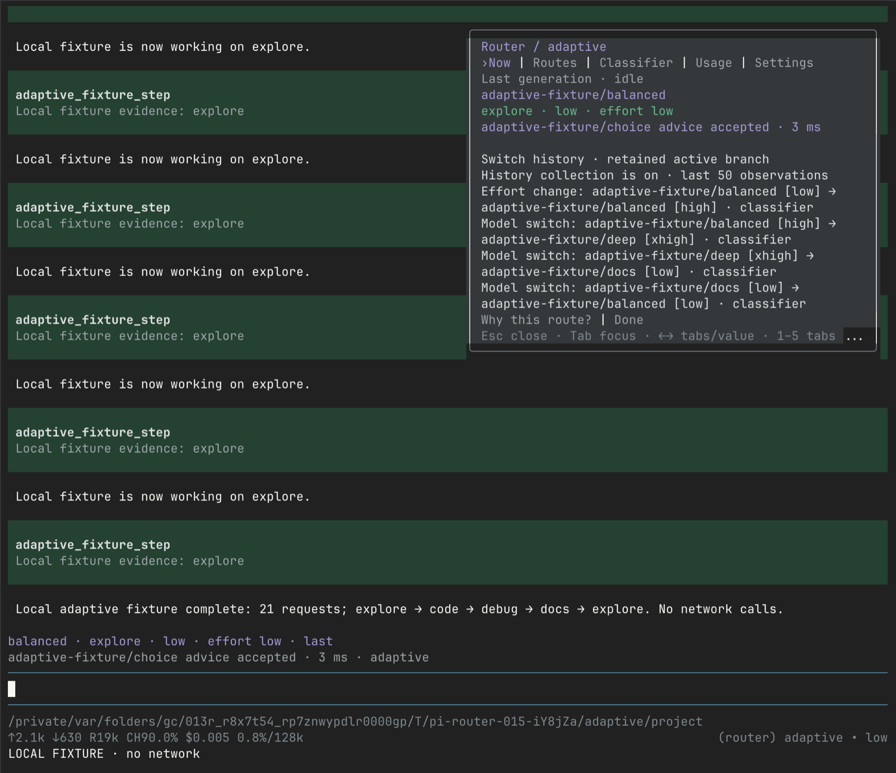
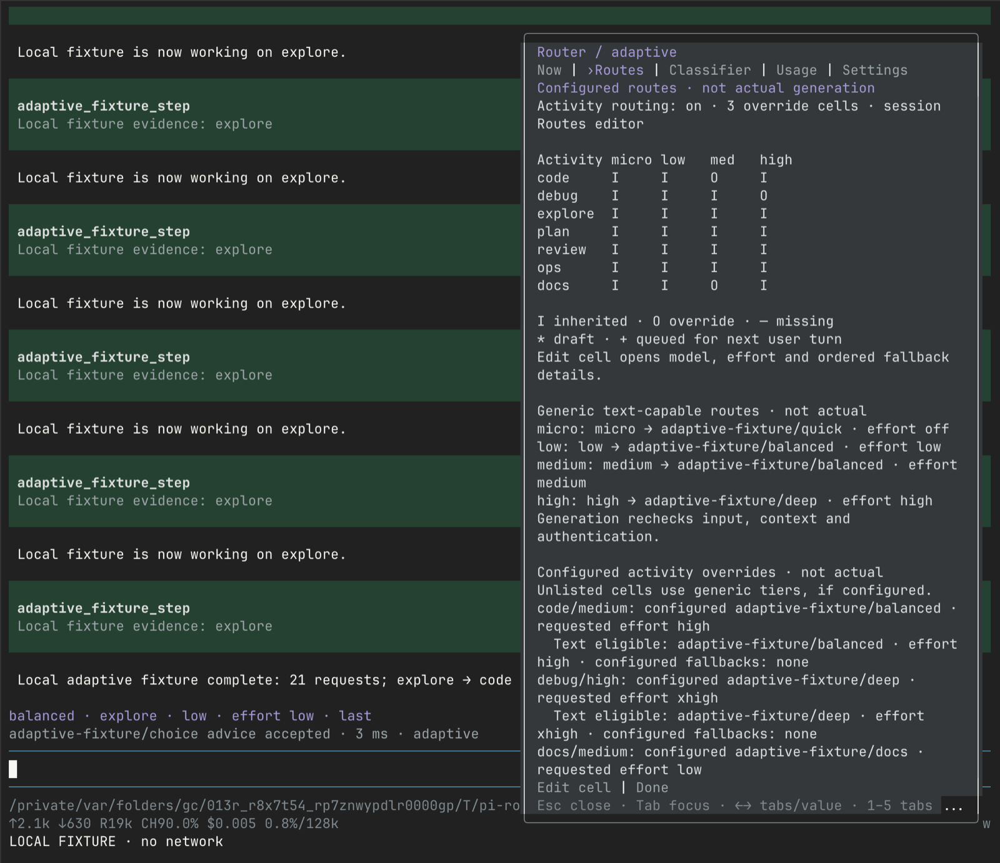
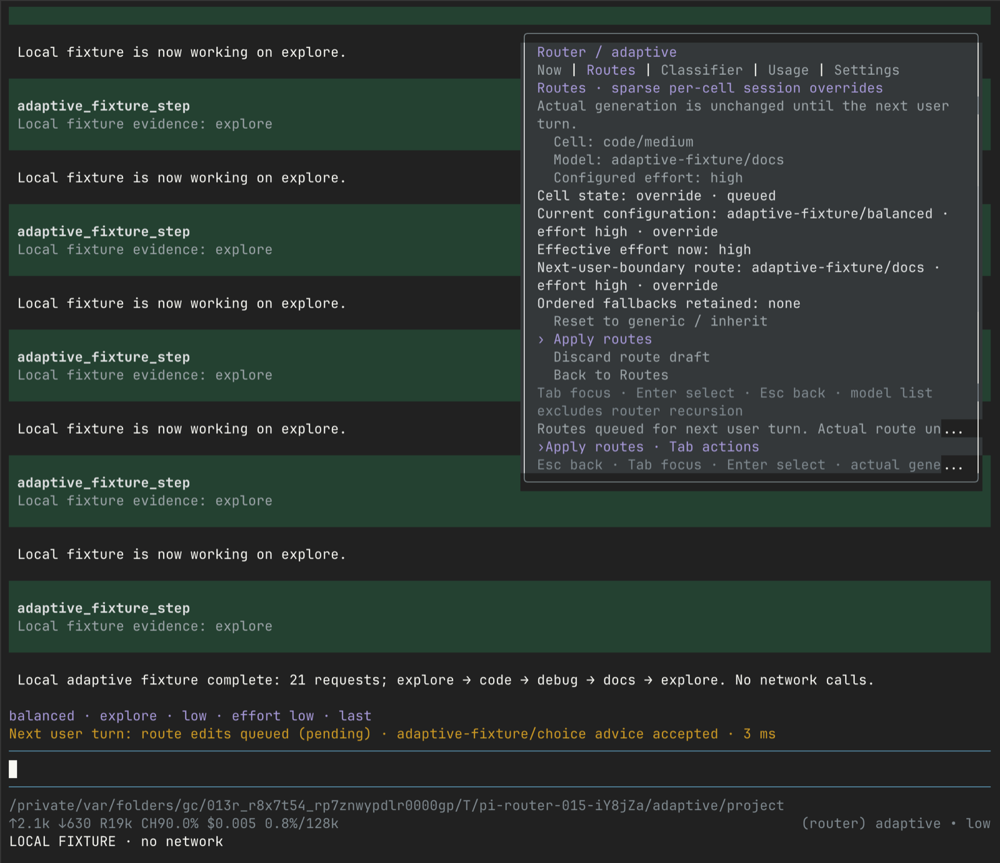
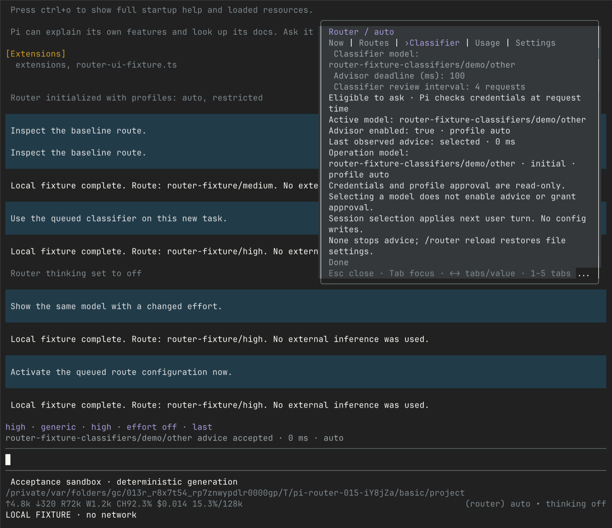
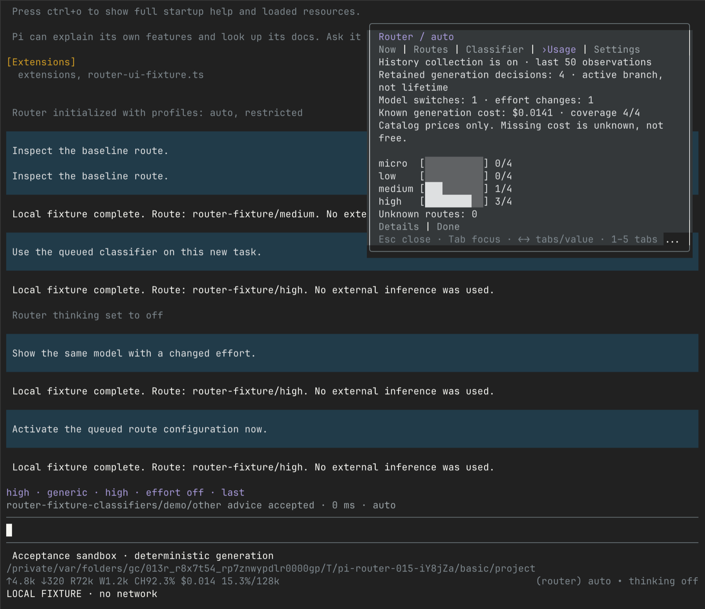
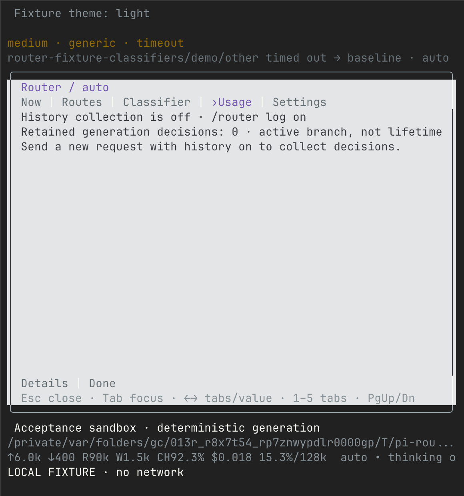
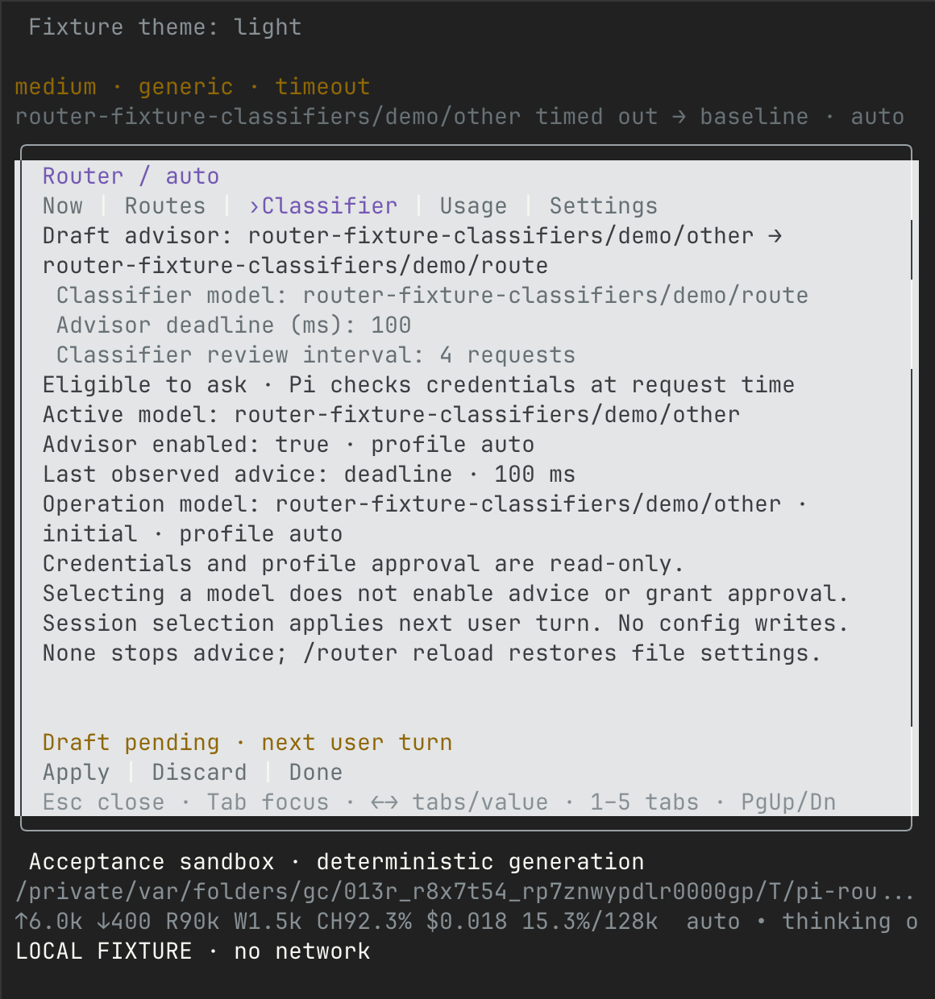
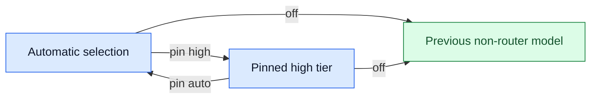

# User guide

A profile maps up to four tiers to models and reasoning effort.
The tiers are `micro`, `low`, `medium`, and `high`. They do not control tool permissions.
Pi supplies the providers, credentials, and tool permissions.

## First profile

1. Open Pi's `/model` selector to find available models.
2. Authenticate the chosen providers through Pi.
3. Create `~/.pi/agent/model-router.json`.
4. Add a profile to that file.

This example uses illustrative model references. Replace them with models and effort levels that your Pi registry supports.

```json
{
  "profiles": {
    "auto": {
      "baselineTier": "medium",
      "medium": { "model": "openai-codex/gpt-6.1-terra", "thinking": "medium" },
      "low": { "model": "openai-codex/gpt-6-luna", "thinking": "high" }
    }
  }
}
```

5. Run `/router reload`.
6. Run `/router profile auto`.
7. Send a short request, such as `Reply with ready.`
8. Run `/router` to inspect the result.

With this profile and no active advisor or pin, the completed route has this
illustrative two-line strip:

```text
gpt-6.1-terra · base · medium · effort medium · last
Local eligible baseline · auto · balanced (default)
```

The baseline is the configured default, not a tier inferred from prompt words.
For semantic task-based selection, [configure and approve a classifier](classifier-advisor.md#configure-a-model).
The first profile above does not enable one.

## Understand the result

| Field                          | Meaning                                                                                                                               |
| ------------------------------ | ------------------------------------------------------------------------------------------------------------------------------------- |
| Model ID                       | The actual generation target, not just the advisor's choice.                                                                          |
| Activity / `base`              | Validated activity, or the base route without an activity choice. [Read activity labels](activity-routing.md#understand-the-display). |
| Tier / effort                  | The configured tier and reasoning effort that ran. Narrow strips omit secondary fields first.                                         |
| `last`                         | The last completed route, not a currently running request.                                                                            |
| Advisor name                   | The configured Pi classifier model reference.                                                                                         |
| `Tool route reused`            | No new advisor request. Prior latency is not presented as a new request.                                                              |
| `timed out → baseline`         | Advice failed but an eligible generation baseline ran.                                                                                |
| `Explicit generation fallback` | Another configured generation target ran, possibly in the same tier.                                                                  |
| `Next user turn`               | Applied controls waiting for a user turn; actual generation is unchanged.                                                             |

With the legacy custom provider, Pi's logical `/thinking` selection and saved
assistant-message `thinkingLevel` are not authoritative physical-effort records;
the host can stamp the request's earlier logical level after streaming.
Use router Now, the route strip and the recorded router decision for the routed
effort. [Native wire/server verification](testing/terra-018-acceptance.md#real-openai-generation)
checks this distinction.

The strip uses two lines. Hide it with `/router widget` to use one compact footer
status instead. The router never replaces Pi's footer or repeats its own route
in both places. Warning colors mark recovered problems and budget policy;
generation failure uses the error color. Colors always have text labels.

## Native inspector

Open **`/router`** for five tabs: **Now · Routes · Classifier · Usage · Settings**.
Use `/router routes`, `/router classifier`, `/router usage` or `/router settings` to open a tab directly.

| Tab            | What it shows and controls                                                                                                                                                                                                                                            |
| -------------- | --------------------------------------------------------------------------------------------------------------------------------------------------------------------------------------------------------------------------------------------------------------------- |
| **Now**        | Actual physical model, activity, tier and effort. Up to four recent retained model/effort transitions, with local reasons. Held proposals and queued controls stay separate from actual generation. **Why this route?** expands budget and route details.             |
| **Routes**     | Activity × tier grid: `B` built-in, `I` inherited, `O` override, `—` missing, `*` draft, `+` queued. **Edit cell** opens the existing activity/tier, searchable physical-model and supported-effort selectors. Configured routes are not advice or actual generation. |
| **Classifier** | Exact selected and active classifier, enablement, profile approval, registration/text-input problems and last observed operation. Model, deadline and review interval are session controls. Credentials and approval are read-only.                                   |
| **Usage**      | Retained generation count, model switches versus effort-only changes, known-cost coverage and route mix. **Details** exposes advisor, HTTP, cache and other diagnostics. A prominent logging-off message explains empty history.                                      |
| **Settings**   | Pin and session mode first. **Advanced** exposes baseline, soft budget, tier-wide effort and switch-cost policy. Route editing and classifier controls live in their own tabs.                                                                                        |

The switch trail uses adjacent known generation targets in retained active-branch history.
It does not count advisor-only reviews as generation, join transitions across unknown targets,
or infer a switch before the retained window. It is not a lifetime switching counter.



### Routes and pending edits

The grid promotes sparse activity routes without hiding them behind Settings.
The editor labels built-in, inherited and overridden cells, preserves ordered fallbacks,
and can reset a cell to generic inheritance. Confirming an unchanged target does
not erase its capability metadata. Use **Apply routes** or **Discard routes**.

Edits queue for the **next user turn**, not the next tool request. Browsing,
drafting and applying pending routes do not change actual generation or write
configuration files. Compare-and-set validation rejects conflicting edits.
Unlisted cells inherit generic tiers. With activity routing off, the declarations
remain visible but are excluded from selection.

A tier-wide effort override applies to every activity and takes precedence over
cell effort. The editor shows configured and effective values. Clear the tier
override to use the cell effort. Model catalogs are not authentication checks:
generation rechecks input, context and credentials.




### Classifier selection and readiness

The Classifier tab explains disabled, unconfigured, unregistered, non-text and
unapproved states. **Eligible to ask** does not attest authentication or guarantee
a call: pins, budgets and single-plan rules still apply. Pi resolves credentials
at request time. See [classifier setup and privacy](classifier-advisor.md).

Left/Right cycles a stable list of registered text classifiers. **None (session)**
stops advice after Apply and the next user turn. Run `/router reload` to restore
file-backed advisor settings. Selecting another model cannot enable advice or
grant profile approval.

Last-operation diagnostics remain visible while history collection is off and
refresh when classification completes, without waiting for generation to finish.
The operation model, source and profile are labeled separately from the current
selection. These are observations, not proof of a new HTTP call on every tool step.



### Usage and logging

Usage starts with a compact summary. Missing prices remain unknown, not free.
History collection off is distinct from no generation. Run `/router log on` to
collect future observations; it does not reconstruct older decisions.




### Keyboard, resize and session scope

With the tab row focused, use Left/Right or **1–5** to change tabs.
Tab/Shift+Tab changes focus. Left/Right or Enter changes a selector value.
Numeric fields use normal text editing. Page Up/Down scrolls. Enter activates
the focused action. The active tab remains labeled when the terminal is too
narrow to show all five names.

In Routes, Enter opens a native selector. Model search uses the Input field,
then Tab moves to the results. Escape returns from a picker to the editor,
then to Routes. From a top-level tab, Escape closes the inspector and discards
unapplied drafts.

Control drafts are shared between Classifier and Settings. **Apply** queues all
changed control fields. **Discard** affects that draft. **Undo** reverses only
unchanged editor-owned control fields. Route drafts use their separate actions.
Nothing writes router configuration files or changes provider authentication.

The inspector is a right overlay at 100 columns or wider. Narrow terminals use
a custom screen. Resize preserves the active tab, expanded details and drafts,
then restores focus to the tab row. Mouse input is not required.



Pin, tier effort and baseline are profile-scoped. The activated mode override is session-wide and survives resume. Cell route edits are session-only
profile overrides. Advisor, deadline, budget, review cadence and switch-cost
policy are session-wide and activate on the next user turn. The mode selector follows that timing too. Activated pins and
effort use branch-safe persistence. Pending edits and baseline/advisor/deadline/
budget/review/switch-policy session overrides reset on reload or replacement.
Use user configuration, or its chezmoi source, for durable settings.

Outside TUI, these commands return text without inference. Print writes to stderr,
JSON emits a `router-inspector` message, and RPC uses notifications.
`/router status` always returns short text.

Screenshots show actual Pi/agterm sessions with local synthetic fixtures. Their
models, prices, deadlines and review intervals are illustrative, not recommended
defaults. See [native acceptance and limits](testing/router-observability-015-acceptance.md).

Usage is **not lifetime accounting**. `/router log on` starts collection;
turning it off preserves existing history, and clearing it clears this view.
Classifier calls are deduplicated by local request ID. Attempts and reused decisions are counted separately. Missing costs are unknown, not zero. Do not add these
observations to overlapping host totals.

The session gauge uses **recorded catalog cost**, not an invoice or precise
remaining allowance. Missing reports can leave it partial. The fill stops at
100%, while the percentage can exceed 100%. No budget means no percentage.
Advisor charges are excluded; the budget is not a hard cap.

These images are real Pi/agterm captures using synthetic local fixtures,
not the HTML prototype. See [validation evidence](testing/signal-panel-acceptance.md).

## Choose a routing mode

Modes are already supported: `cost`, `balanced` (default) and `quality`.
Use `/router mode` for a next-request change, or the Settings selector for a queued next-user-message change.
See [routing modes](routing-modes.md) for the complete preference table, controls, precedence, policy tuning and recovery.

### Repeated tool failures

In one user turn, the same tool can fail twice with the same output, with a
successful `edit` or `write` between the failures. Then the router routes at
least one tier above the route that failed. This starts at the next request and
lasts for `escalationHoldTurns` more user turns. It applies in every mode,
`balanced` included. Ordinary tier escalation does not apply at `high`, with a pin, or on a Google
thought-signature continuation. The log shows reason `escalation` and
`escalated from <tier>`.

A validated cost-transformed high route can instead restore its balanced high cell. See [cost recovery](routing-modes.md#recover-from-a-failing-cost-route).

The hold belongs to the failing turn's user message. It ends early if
compaction removes that message, and it does not apply on another branch.
The hold is not saved, so reload and resume end it.
The match ignores tool arguments and digits. Two unrelated failures of the same
tool with the same message, with an edit between, also escalate.

Escalation cannot be turned off. To limit it to the rest of the failing turn
in every mode, set the hold to 0 in the switch policy and in both mode patches.
The other mode values stay:

```json
{
  "switchPolicy": { "escalationHoldTurns": 0 },
  "modes": {
    "cost": { "policy": { "escalationHoldTurns": 0 } },
    "quality": { "policy": { "escalationHoldTurns": 0 } }
  }
}
```

## Take control



- Run `/router pin high` to restrict selection to high.
- Run `/router pin auto` to clear the pin.
- Run `/router off` to return to the previous non-router model.

Here, `auto` is a profile name. The argument in `pin auto` clears a pin instead.
An ineligible pin produces an error. The router does not substitute another tier.
A pin to a tier whose context window is too small for the conversation keeps that tier; old turns are truncated.

An effort override applies to every tier in the active profile.
Each model runs the override at its nearest supported level. For example, `off` runs as `minimal` on a model without `off`. The confirmation names each tier that runs another level, such as `high runs at minimal`.
Pi's thinking selector, such as Shift+Tab, sets the same override.
An override that removes every eligible route produces an error without a partial configuration change.
Use `/router thinking auto` to clear the override.

## Common problems

| Symptom                                             | Action                                                                                                                                                               |
| --------------------------------------------------- | -------------------------------------------------------------------------------------------------------------------------------------------------------------------- |
| No eligible route                                   | Make sure that the model exists in `/model` and supports the input. Check `reasoning` and `thinkingLevels` in the configuration.                                     |
| The baseline handles every request                  | Inspect `/router`. Enable an advisor for semantic selection, or clear a pin.                                                                                         |
| Classifier does not run                             | Check registration, credentials, `advisor.enabled` and the active profile's exact approval. See [classifier troubleshooting](classifier-advisor.md#troubleshooting). |
| Usage shows zero decisions                          | Run `/router log on`, then send a new request. Collection was off or history is empty; this is not a generation count.                                               |
| Old Jev/Clef configuration stopped selecting models | Replace retired settings with `advisor`; see [migration](#from-011x-to-012x).                                                                                        |
| Old behavior after a provider extension change      | Run `/reload` or start a new Pi session; `/router reload` only reloads router configuration.                                                                         |
| Provider context overflow                           | Reduce the active context. Text estimates cannot guarantee that images or a large tool turn fit.                                                                     |

## Command reference

| Command                                           | Action                                                               |
| ------------------------------------------------- | -------------------------------------------------------------------- |
| `/router`                                         | Open Now, or return text outside TUI.                                |
| `/router routes`                                  | Open the configured route grid and per-cell editor.                  |
| `/router classifier`                              | Open classifier readiness, selection and last-operation diagnostics. |
| `/router usage`                                   | Inspect retained decisions and known costs.                          |
| `/router settings`                                | Inspect and edit session controls in TUI.                            |
| `/router status`                                  | Return short text status.                                            |
| `/router profile <name>`                          | Select a profile and enable the router.                              |
| `/router off`                                     | Restore the previous non-router model.                               |
| `/router pin <tier\|auto>`                        | Pin a tier or return to automatic selection.                         |
| `/router thinking <level\|auto>`                  | Override effort for the profile or clear the override.               |
| `/router mode [cost\|balanced\|quality\|default]` | Show the routing mode, set a session override, or clear it.          |
| `/router log [on\|off\|clear]`                    | Show recent decisions, control collection, or clear history.         |
| `/router widget`                                  | Toggle the status widget.                                            |
| `/router reload`                                  | Reload router configuration, not Pi provider extensions.             |
| `/router help`                                    | Show command help.                                                   |

Per-tier effort can be set in the profile configuration or as a session override in the inspector.
The old bare profile shorthand returns a migration hint without switching. Use
explicit `profile <name>`, including profiles whose names match commands.

## Configuration reference

| File                                  | Purpose                                                                                                                                                                                                                                                                                                                                                                                                                                                                          |
| ------------------------------------- | -------------------------------------------------------------------------------------------------------------------------------------------------------------------------------------------------------------------------------------------------------------------------------------------------------------------------------------------------------------------------------------------------------------------------------------------------------------------------------- |
| `~/.pi/agent/model-router.json`       | User configuration and external-advisor approval. A custom Pi agent directory changes this location.                                                                                                                                                                                                                                                                                                                                                                             |
| `.pi/model-router.json`               | Project routes (`profiles.<name>` tier and activity cells, `baselineTier`), `activityRouting`, `ui` and `mode`. Other keys are ignored with a warning, including model aliases, `switchPolicy`, `modes`, `maxSessionBudget`, `debug` and all advisor settings. Project routes can still name any registered model, replace a same-named user profile's routes and set route capabilities; use project files only from repositories you trust. You can keep this file out of Git. |
| `~/.pi/agent/models.json`             | Pi-owned model and credential configuration, not router aliases or classifier approval.                                                                                                                                                                                                                                                                                                                                                                                          |
| `~/.pi/agent/extensions/`             | Optional Pi provider/catalog extensions. Changes require `/reload`.                                                                                                                                                                                                                                                                                                                                                                                                              |
| `~/.pi/agent/model-router-state.json` | Last selected profile. The extension manages this file.                                                                                                                                                                                                                                                                                                                                                                                                                          |

CAUTION: Keep credentials out of Git. Selected conversation text can contain secrets even with bounded advisor context.

A profile needs at least one generic or activity tier. A partial profile is valid.
Profile names must be nonempty, contain no whitespace and not be `__proto__`.
Command names such as `usage` are valid profiles: use `/router profile usage`.
The router filters unavailable models and unsupported input before selection. An unsupported effort runs at the nearest supported level.
`off` or `minimal` at `low`, `medium` or `high` disables that tier with a warning, unless the model is declared `reasoning: false`. `micro` can use `off`.
`baselineTier` prefers a configured tier. Without it, the preference is `medium`, `high`, `low`, then `micro`.
The [complete example](../model-router.example.json) shows aliases, tier/activity routes and classifier approval. Its advisor starts disabled; follow [classifier setup](classifier-advisor.md#configure-a-model) before enabling it.

| Field                                 | Behavior                                                                                                                                                                                                                       |
| ------------------------------------- | ------------------------------------------------------------------------------------------------------------------------------------------------------------------------------------------------------------------------------ |
| `profiles.<name>.activityPreset`      | User-only `"auto"` by default. `"off"` disables automatic activity/mode defaults while retaining explicit activity routes and legacy tier-mode transforms. [Tuning and precedence](activity-routing.md).                       |
| `activityRouting`                     | `"on"` by default; `"off"` excludes activity overrides entirely. These are the only modes; there is no shadow mode.                                                                                                            |
| `maxSessionBudget`                    | Soft threshold for reported generation cost. Unpinned requests skip advisors and prefer eligible medium-or-lower tiers after this threshold.                                                                                   |
| `advisor`                             | User-only Pi classifier model, approval, bounded context, deadline, probability settings and in-loop review interval. See [classifier setup](classifier-advisor.md).                                                           |
| `advisor.reviewEveryRequests`         | Run a nonblocking classifier review every N valid tool-loop requests (default 4); 0 disables. A result applies only to the immediately following request.                                                                      |
| `switchPolicy.horizonRequests`        | Cost-comparison horizon, 1–20 requests (default 5).                                                                                                                                                                            |
| `switchPolicy.costSensitivity`        | 0 is opportunistic (accepts a larger estimated premium); 1 only accepts switches no more expensive than staying. Default 0.5.                                                                                                  |
| `switchPolicy.escalationHoldTurns`    | User turns after the failing turn that keep a [repeated-failure escalation](#repeated-tool-failures), 0–20 (default 2). 0 limits it to the failing turn. `cost` and `quality` replace it unless `modes.<mode>.policy` sets it. |
| `profiles.<name>.switchPolicy` | User-only partial policy override. See [policy precedence](routing-modes.md#tune-switching-policy). |
| `profiles.<name>.notificationTypes` | User-only exact native custom-message types treated as progress, not new goals. See [notification recognition](classifier-advisor.md#goals-steering-and-notifications). |
| `profiles.<name>.mode`                | Routing mode for the profile: `cost`, `balanced` or `quality`. See [routing modes](#choose-a-routing-mode).                                                                                                                    |
| `modes.<mode>.policy`                 | Switch-policy values for one mode, which replace the built-in mode values.                                                                                                                                                     |
| `switchPolicy.strongAdviceConfidence` | Minimum relevant classifier confidence that can override estimated switch cost. Default 0.9. Tier and activity confidence are independent.                                                                                     |
| `models`                              | Aliases with a `model` reference, optional `contextWindow`/`maxTokens`, and exact `effortCacheSharing: shared\|separate\|unknown` metadata. Omitted metadata means unknown.                                                    |
| `ui.statusLine`                       | `compact` by default. `detailed` adds the full provider/model reference and recorded catalog cost, still within two widget lines.                                                                                              |

Budgets and model capacities must be positive, finite numbers. Invalid values are ignored with a warning.
The budget is not a spending cap. It excludes advisor costs, and a pin takes priority.
Without an eligible lower tier, the budget policy keeps an eligible baseline.
The initial classifier deadline defaults to 10 seconds. An unavailable model, rejected answer, timeout or provider error on initial selection uses the local baseline; a failed background review keeps the eligible incumbent. Profile approval is required for the exact configured classifier model.

## Activity routes

Recognized OpenAI and Claude profiles now receive complete built-in activity presets.
Existing profiles activate them on reload. Your explicit activity cells keep their generic inheritance and take priority.

Start with [activity routing: defaults and tuning](activity-routing.md).
It covers the complete matrices, recognition, migration, per-cell changes, reset, opt-out and troubleshooting.
The native Routes editor can try changes without editing files.

## Read costs and cache data

After a terminal response, `/router log` exposes:

- Input, output, cache-read, and cache-write tokens for the last terminal attempt.
- The model transition and the total attempt count.
- Reported catalog cost across attempts, with failed attempts included.
- Hypothetical stay/switch prices for the same measured tokens.

An attempt without terminal usage makes the request total unknown. The session total still includes known costs.
Zero placeholder tariffs do not establish free generation.
Catalog prices do not establish subscription charges.

The diagnostics-only shadow comparison still does not predict savings. Fresh in-loop advice separately estimates stay versus switching over the configured horizon: the first target request is cold (using the greater of ordinary input/cache-write catalog cost, with request-wide output pricing); later target requests and staying use the same last-observed read-share scenario, or an explicit all-read scenario if no share is known. Output volume is reused from the latest request. Rebuild premium and steady generation-price difference are separate diagnostics. Initial new-user advice is not held by the previous task's estimate. This is an explicit catalog scenario, not a prediction, invoice, cache-hit promise, or quality score.

Same-model effort changes have no estimated rebuild penalty only when the operator declares `effortCacheSharing: "shared"` for the exact model/backend currently configured. This is not provider verification and never means generation or extra reasoning tokens are free. `"separate"` prices the switch like a cold route change. Missing or conflicting metadata means `unknown`: the effort change is allowed, but the UI does not claim cache preservation. Cross-model switches with missing/placeholder rates also remain eligible and are marked cost-unknown; missing price is not treated as free evidence. Strong tier/activity evidence above `strongAdviceConfidence` can override a catalog cost hold.
The [evaluation](evaluation.md) separates observed use from hypothetical cost.

## Sessions and history

Pins, costs, display controls, and recent decisions follow the Pi session branch. Adaptive switch session overrides reset on reload or session replacement; put durable policy in configuration. A routing-mode override follows the session: resume keeps it, `/new` does not.
Debug collection retains the last 50 generation/review observations. Usage separates generation decisions from terminal classifier diagnostics and deduplicates classifier IDs, including reviews that expired or did not apply. Turning collection off preserves existing history and the latest decision.

An explicit startup `--model` takes priority.
Otherwise, a resumed branch uses its saved state.
When Pi starts on the router provider, a new session uses the last profile.
A restored router snapshot does not restore a server cache.
New snapshots are bound to the native session ID. A fresh fork does not restore
foreign-owner controls, costs or decisions. Replacement/reload aborts old routing
requests and resets route caches; late completions cannot update the new session.

Fresh SDK sessions must create their own router extension factory/runtime.
Native pi-subagents auto-integration and inherited shared-provider runtimes are
not supported; SDK isolation is not proof of inherited policy enforcement.
See the [required upstream contract](architecture.md#native-child-integration-boundary).

## Migration

### From 0.17.x to 0.18.0

Before upgrading, set `profiles.<name>.activityPreset: "off"` if you do not want
new automatic defaults. Otherwise recognized OpenAI activities introduce Terra
and model-first mode preferences on reload; spending and physical targets can change.
Generic declarations and explicit activity cells remain user-owned.
Only a generic ladder matching the new example gets automatic generic mode alternatives.
See [the exact ownership and precedence](routing-modes.md#openai-default-preferences).

Restart Pi or run `/reload` after updating the package. `/router reload` only
reloads configuration. Check Routes and your exact provider's live catalog;
registration under another provider does not grant access.
No classifier consent, permission boundary or fallback provider is added.

### From 0.15.x to 0.16.0

Restart Pi after upgrading. Configuration without `mode` routes as before
(`balanced`). Check these changes:

1. **Project files (security fix).** `.pi/model-router.json` can now set only
   routes, `activityRouting`, `ui` and `mode`. Model aliases, `switchPolicy`,
   `modes`, `maxSessionBudget`, `debug` and other keys are ignored with a
   warning. Move them to the user file if you need them. Before 0.16.0, a
   cloned repository could change these settings. Project routes can still
   name any registered model and set route capabilities such as
   `reasoning: false`. Open project files only from repositories you trust.
2. **Thinking floor.** `off` or `minimal` at `low`, `medium` or `high` now
   disables that tier with a warning, unless the model is declared
   `reasoning: false`. Use `low` or higher, or move the route to `micro`.
3. **Escalation in `balanced`.** A [repeated tool failure](#repeated-tool-failures)
   now raises the route one tier for two more user turns. To limit it to the
   rest of the failing turn, [set the hold to 0](#repeated-tool-failures) in
   `switchPolicy` and in the `cost` and `quality` mode patches.
4. **Saved sessions.** A session saved by 0.15 restores without a mode override.

### From 0.14.x to 0.15.0

Restart Pi after upgrading so the new inspector and commands load.
No routing-policy or configuration-format migration is required.
Use the new Routes and Classifier tabs instead of looking for those controls
under Settings → Advanced. Existing pins and exact classifier approvals remain.
Run `/router log on` if the resumed session had collection off.

### From 0.10.x to 0.11.0

1. After upgrading, restart Pi. Replace `/router-ui` and `/router-ui now` with
   `/router`; use `/router usage` for usage and `/router settings` for both old
   Routing and Classifier sections. The removed command no longer opens a UI.
2. Replace `/router auto` (or another bare profile) with `/router profile auto`.
   Old shorthand gives a migration hint instead of switching. Command-named
   profiles stay accessible through the explicit profile argument.
3. Use `/router status` for the short text summary. New sessions show the strip
   by default; restored sessions retain their widget preference. Use
   `/router widget` for a quiet footer instead. Detailed status stays at two
   lines; cache/probability diagnostics remain in `/router log`.

The generic classifier migration is documented below.

CAUTION: Do not load this fork and the upstream extension together. Both register the `router` provider.

```sh
pi remove npm:@yeliu84/pi-model-router
pi install npm:@alexeiled/pi-model-router
```

If a manifest loads the upstream extension, remove that entry instead.
Deprecated `rules` and `phaseBias` produce a warning but have no routing effect.

## From 0.11.x to 0.12.x

The advisor now uses Pi's public `modelRegistry.classify()` operation.
Legacy Jev, Cloudflare and chat-classifier settings are not migrated automatically.
A file containing old settings can load without enabling any classifier.

1. Remove the retired provider-specific settings, including profile-level Jev opt-ins.
2. Configure credentials in Pi. Do not move keys or endpoints into `advisor`.
3. Set user-level `advisor.enabled: true` and an exact `advisor.model` reference.
4. Add that same reference to each intended profile's `advisor.models` approval list.
5. Use `/reload` after installing a provider extension, or `/router reload` for configuration-only changes.
6. Run `/router log on`, send a new request and inspect the recorded decision.

See [supported classifier models and complete setup](classifier-advisor.md).
Registration, enablement and profile approval are three separate requirements.
